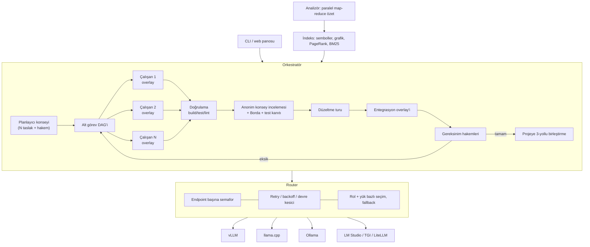

# Kurultay

**Kapalı ağda çalışan, elinizdeki tüm yerel LLM'leri aynı anda kullanan kodlama ajanı.**

Kurultay, verdiğiniz OpenAI-uyumlu endpoint'leri ve API anahtarlarını kullanarak:

1. **Her modelin yeteneklerini ölçer.** Bağlam penceresi, tool calling, JSON, hız, eşzamanlılık kapasitesi, kodlama ve düzenleme başarısı ölçülür; her modele rol puanı verilir.
2. **Projeyi indeksler.** Semboller, bağımlılık grafiği, PageRank ve BM25 araması çıkarılır. Ardından **tüm modellere paralel dağıtılan** map-reduce özetleme ile `ARCHITECTURE.md`, modül dokümanları, uçtan uca **akış dokümanları** (DeepWiki tarzı, kaynak satır referanslı, Mermaid diyagramlı) ve ajanların her görevde okuduğu `PROJECT_NOTES.md` üretilir.
3. **Verilen işi yapar.** Plan modellerden oluşan bir konseyde hazırlanır. Alt görevler modellere **eşzamanlı** dağıtılır. Kritik işlerde birden çok model yarışır. Her aday build/test ile doğrulanır. Adaylar **anonim konsey incelemesi** ile sıralanır. Son olarak gereksinim kontrolü yapılır; eksik varsa döngü devam eder.

Çalışma zamanında **hiçbir npm bağımlılığı yoktur**. Gereken tek şey Node.js ≥ 20. Native derleme, Python, Docker, CDN veya telemetri gerekmez.

> Adı: *Kurultay*, Türk-Moğol geleneğinde kararların birlikte alındığı meclis. Buradaki meclis üyeleri sizin LLM'leriniz.

---

## Neden?

Bu projeden önce 15 açık kaynak ajan incelendi. Hiçbiri aynı işi tüm yerel modellere eşzamanlı dağıtıp sonuçları test ve çapraz review ile birleştirmiyordu. Hepsi ya rol bazlı çalışıyordu (her ajana tek model) ya da birbirinden habersiz paralel instance'lar açıyordu. Kurultay bu boşluğu doldurur ve incelenen projelerin en iyi fikirlerini bir araya getirir:

| Fikir | Kaynak proje | Kurultay'da |
|---|---|---|
| Tree-sitter + PageRank repo haritası | Aider | `src/index/*` – bağımlılıksız sembol çıkarıcı, referans grafiği, kişiselleştirilmiş PageRank |
| Architect / Editor ayrımı | Aider | Planlayıcı ve kodlayıcı rolleri, rol puanına göre model seçimi |
| Rol bazlı model yönlendirme + fallback zinciri | omp, oh-my-openagent | `Router` – rol puanı × yük × güvenilirlik; otomatik yedek model |
| Hash/anchor tabanlı dayanıklı düzenleme | omp | `edits.ts` – birebir → boşluk toleranslı → girinti toleranslı eşleşme, "en yakın eşleşme" ipucu |
| Minimal, genişletilebilir çekirdek | Pi (pi-mono) | Küçük modüller; kütüphane olarak da kullanılabilir (`import { Orchestrator } from 'kurultay'`) |
| Sisyphus orkestrasyonu / TODO takibi | oh-my-openagent | Plan DAG'i, bağımlılık sırasıyla paralel yürütme, iterasyon döngüsü |
| Git worktree ile paralel ajan izolasyonu | Kilo Code, Cline | **Copy-on-write overlay**: worktree'den hafif, repo kopyası gerektirmez, 3-yollu birleştirme yapar |
| LSP/sembol düzeyinde gezinme | Serena, Crush | `find_symbol`, `repo_map`, bağımlı dosya listesi araçları |
| Hiyerarşik wiki / mimari dokümanı | DeepWiki-Open | Dosya → modül → mimari özetleri, deterministik Mermaid modül grafiği |
| LLM Konseyi (anonim karşılıklı değerlendirme + başkan) | karpathy/llm-council | Plan, mimari dokümanı, kod incelemesi ve `ask` komutunda konsey |
| Prompt tabanlı tool calling yedeği | OpenHands, Goose (toolshim) | Native tool desteklemeyen modeller `<tool_call>`, Qwen3-Coder XML veya SEARCH/REPLACE ile çalışır |
| Bağlam yoğunlaştırıcı (condenser), event-sourcing | OpenHands | Uzun oturumlarda geçmiş özetlenir; tüm olaylar `events.jsonl` dosyasına yazılır |
| Diğer ajanların kural dosyalarını okuma | omp | `AGENTS.md`, `CLAUDE.md`, `.cursorrules`, `.clinerules/`, `.github/copilot-instructions.md` |
| Plan → Act akışı, headless mod | Cline, Qwen Code | `run` komutu tek seferde plan + uygulama yapar; CI'da etkileşimsiz çalışır |

Lisans gerekçesiyle **hiçbir projeden kod kopyalanmadı**; fikirler sıfırdan, MIT lisansıyla yeniden yazıldı. FSL lisanslı Crush yalnızca fikir kaynağı olarak incelendi.

---

## Mimari



### Tüm modeller nasıl eşzamanlı kullanılıyor?

| Aşama | Eşzamanlılık |
|---|---|
| `probe` | Tüm endpoint'ler paralel incelenir. Her endpoint'te 1→2→4→8 istekle verim rampası yapılır ve en iyi paralellik seviyesi kaydedilir. |
| `analyze` | Dosya partileri **tüm modellerin toplam slot sayısı** kadar paralel özetlenir; hızlı model daha çok iş alır (yük duyarlı router). Mimari dokümanı için N model bağımsız taslak yazar, hakem model birleştirir. |
| Planlama | En iyi 3 planlayıcı paralel taslak üretir, hakem birleştirir. |
| Yürütme | **split**: bağımsız alt görevler farklı modellerde aynı anda çalışır. **race**: aynı alt görevi N model yarışarak çözer. **council**: race + her durumda tam konsey incelemesi. **auto**: tek alt görevde race, çok alt görevde split (kritik olanlar 2 modelle). |
| İnceleme | Tüm gözden geçirenler paralel çalışır; adaylar A/B/C olarak anonimleştirilir ve sıraları karıştırılır. Kodu yazan model kendi kodunu incelemez (tek adayda hiç, konseyde kendi adayına oy veremez); düzeltmeler yazar olmayan bir modelce yeniden incelenir. |
| Gereksinim kontrolü | 2 hakem paralel karar verir; ikisinin de "tamam" demesi gerekir. |

### Dayanıklılık

- **Model yanıt vermezse** (takılma, zaman aşımı): her istek üç saatle izlenir — ilk token süresi (varsayılan 180 sn + uzun istemler için ek pay), akış sessizlik süresi (90 sn) ve toplam süre (10 dk). Süre dolan model aynı istekte tekrar denenmez, **karantinaya alınır** (2 dk, tekrarlarda 16 dk'ya kadar uzar) ve hiçbir çalışan ona istek göndermez.
- **Çalışan kalıcı olarak model değiştirir**: görevi yürüten model düşerse görev, bağlamı sığan en iyi yedek modelle kaldığı yerden sürer; düşen model o görevde bir daha kullanılmaz. Yedek model native araç çağrısı desteklemiyorsa konuşma geçmişi metin protokolüne çevrilir. Değişimler raporda listelenir.
- **Bağlantı koparsa** üstel backoff ile tekrar denenir. Tüm modeller düşerse 10 dakikaya kadar bekleyip yeniden denenir (devre kesiciler sıfırlanır).
- **Bağlam taşarsa** prompt'u sığdıran modellere yönlendirilir. Uzun çalışmalarda condenser önce eski araç çıktılarını kırpar, sonra geçmişi yapılandırılmış bir devir notuna (hedef / yapılanlar / kararlar / dosyalar / sıradaki adımlar) dönüştürür; not her yoğunlaştırmada artımlı güncellenir.
- **Sunucu `429`/`503` + `Retry-After` dönerse** istenen süre kadar beklenir.
- **Döngü koruması**: aynı çağrı aynı sonuçla 3. kez yapıldığında uyarı verilir, 5. kezde çalışan durdurulur. A-B-A-B gidip gelmeler, uzun salt-okuma keşifleri ve üst üste başarısız çağrılar da yakalanır.
- **Güvenli düzenleme**: var olan bir dosyanın üzerine yazmadan veya silmeden önce okunmuş olması gerekir. Eşleşmeyen bir düzenlemeden sonra dosya yeniden okunmadan tekrar düzenlenemez. Düzenleme sonrası parantez dengesi ve JSON geçerliliği kontrol edilir. CRLF satır sonları korunur; akıllı tırnak ve uzun tire gibi Unicode farkları eşleşmeyi bozmaz; yanlış yazılmış ama tek eşleşmesi olan dosya yolları düzeltilir.
- **Araç çağrısını düzyazıyla anlatan modeller** için (ör. "şimdi read_file ile açacağım") hızlı bir model metni gerçek araç çağrısına çevirir (toolshim).
- **Native tool calling desteklemeyen** veya `tools` alanını reddeden sunucularda otomatik olarak prompt tabanlı araç çağrısına geçilir.
- **Çökme güvenliği**: Build/test sırasında aday değişiklikler geçici olarak diske yazılır. Bu işlem bir journal ile korunur; yarıda kesilirse bir sonraki çalıştırmada orijinal dosyalar geri yüklenir. Bu süre boyunca diğer çalışanlar her zaman orijinal (pristine) içeriği görür.
- **Sizin değişiklikleriniz korunur**: Ajan çalışırken bir dosyayı siz de düzenlediyseniz sonuç 3-yollu birleştirilir. Çakışma olursa git tarzı işaretler eklenir ve raporda listelenir.
- **Kesilen cevaplar** (`finish_reason=length`): JSON/araç çağrısı yarım kaldıysa daha yüksek `max_tokens` ile bir kez yeniden istenir; düz metin cevaplarda model kaldığı yerden devam ettirilir (en çok 2 tur). Düşünen (reasoning) modellere varsayılan olarak daha geniş çıktı bütçesi verilir.
- **Model başına bağlam bütçesi**: her istem, onu okuyacak modelin bağlam penceresine göre hazırlanır; filodaki küçük bir model 128K modellerin bağlamını daraltmaz.

### Kalite: kanıt, ölçüm ve öğrenme

| Özellik | Ne yapar |
|---|---|
| **Yalıtılmış paralel derleme** | Her çalışanın build/test komutları `.kurultay/sandboxes/sb-N` altındaki kendi kopyasında çalışır (copy-on-write klon, `node_modules` bağlantı); gerçek proje yalnızca son birleştirmede değişir. `tools.isolation: "inplace"` eski davranışa döner |
| **Düzenleme sonrası derleyici kontrolü** | C/C++: `compile_commands.json` bayraklarıyla `-fsyntax-only` (başlıklar onları içeren bir çeviri birimi üzerinden; eksik başlıklar boş taslakla değiştirilir). Java: `javac -sourcepath` (`tools.javaRelease: 8` ile Java 8 API sınırı). Yapılandırılmışsa önce **LSP** tanılamaları (clangd, jdtls…). Yalnızca düzenlenen dosyadaki gerçek hatalar modele geri verilir |
| **Önce test** | Çalışan istemi hata düzeltmelerinde önce hatayı yeniden üreten bir test yazmayı, her değişiklikte test bırakmayı ve mevcut testleri zayıflatmamayı ister (`orchestrator.testFirst: false` kapatır) |
| **Zorlanmış JSON** | Plan, inceleme, hakem ve özet istekleri `response_format: json_schema` ile gider (vLLM/llama.cpp/SGLang kısıtlı çözümleme). Desteklemeyen sunucu otomatik olarak `json_object`e düşürülür |
| **Sonuçlardan öğrenen model seçimi** | Her rol için başarı/başarısızlık (`~/.kurultay/model-stats.json`) probe puanıyla harmanlanır; sürekli başarısız olan model o rolde geri plana düşer |
| **Anlamsal arama** | Endpoint'te bir embedding modeli (bge, e5, nomic-embed, Qwen3-Embedding…) varsa kod parçaları vektörlenir (artımlı) ve arama BM25 + kosinüs benzerliğini **RRF** ile birleştirir: "sıcaklık eşiği nerede kontrol ediliyor?" sorusu `MAX_TEMPERATURE` kodunu bulur |
| **Değerlendirme düzeneği** | `kurultay eval <görev-seti>` her görevi temiz bir kopyada çalıştırır, ajan bitince gizli testleri ekler; başarı, istek, token ve süreyi mod bazında `EVAL.md`/`results.json` olarak raporlar. `--validate` görevlerin temelde kaldığını, referans çözümle geçtiğini doğrular |
| **Gözlemlenebilirlik** | `REPORT.md` model başına istek / giriş-çıkış token / ortalama yanıt / hata / kesilme tablosu içerir; `kurultay stats` ve konsolda `/stats` |

---

## Kurulum (kapalı ağ)

İnternet erişimi olan bir makinede:

```bash
git clone https://github.com/ozknScalebor/kurultay.git
cd kurultay
npm ci            # yalnızca derleme araçları (typescript)
npm test          # ≈290 test – sahte LLM sunucularıyla birim, entegrasyon ve CLI
npm run pack:offline
```

`release/` klasörü oluşur:

- `kurultay-<sürüm>.tgz`: Hedef makinede `npm install -g ./kurultay-<sürüm>.tgz` ile kurulur. Çalışma zamanı bağımlılığı olmadığı için internet gerektirmez.
- `kurultay-<sürüm>-portable-<os>-<arch>/`: **Node.js kurulu olmayan** makineler için. İçinde Node çalıştırıcısı vardır; `./kurultay` (Windows'ta `kurultay.cmd`) ile çalışır. Hedef makineyle aynı işletim sistemi ve mimaride paketleyin.

Bu klasörü USB ile kapalı ağa taşımanız yeterli.

## Hızlı başlangıç

### Etkileşimli konsol (önerilen)

```bash
kurultay            # veya: kurultay console --workspace /projem
```

```
 ╦╔═╦ ╦╦═╗╦ ╦╦ ╔╦╗╔═╗╦ ╦
 ╠╩╗║ ║╠╦╝║ ║║  ║ ╠═╣╚╦╝
 ╩ ╩╚═╝╩╚═╚═╝╩═╝╩ ╩ ╩ ╩

LLM ayarları  2 endpoint (2 erişilebilir) · 4 model · 14 paralel slot · yetenek profili: ölçülmüş
  Endpoint
  gpu1            http://10.0.0.11:8000/v1    2 model    ● 18 ms
  ollama          http://127.0.0.1:11434/v1   2 model    ● 6 ms
  Model
  ad                          bağlam  araç    tok/s  paralel  en iyi roller      durum
  gpt-oss-120b@gpu1           128K    native  61     8        planner, judge     hazır
  qwen3-coder-30b@gpu1        256K    native  95     4        coder, reviewer    hazır
  ...
  zaman aşımı: ilk token 3 dk · sessizlik 90 sn · toplam 10 dk · takılan model karantinası 2 dk

Çalışma alanı seçin (zorunlu — projenin kök klasörü)
  1) ~/projeler/uart-driver   şu anki klasör
  2) ~/projeler/gateway       son kullanım 2026-10-21
Çalışma alanı [numara veya yol] ❯ 1
  ✓ indeks: 412 dosya, 3.180 tanım, 1.204 bağımlılık
  ✓ mimari analiz güncel
uart-driver ❯ /
› /help        komutları ve kısayolları göster
  /models      LLM paneli: endpoint sağlığı, modeller, yetenekler, kapasite
  ...
```

- **Açılışta** endpoint'lerin canlı durumu, modeller, ölçülmüş yetenekleri, paralel kapasite ve zaman aşımı ayarları gösterilir. Hiç yapılandırma yoksa ilk endpoint sorulur ve `~/.kurultay/config.json` dosyasına yazılır.
- **Çalışma alanı seçimi zorunludur.** Son kullanılanlar numarayla seçilir, yol Tab ile tamamlanır. Seçince indeks otomatik güncellenir; yetenek profili yoksa hızlı yetenek analizi, değişen dosya varsa artımlı mimari analiz kendiliğinden çalışır (Ctrl+C ile atlanır; `/index`, `/probe`, `/analyze` ile elle de yapılır).
- **`/` yazınca komut menüsü açılır**; yazdıkça süzülür, ↑/↓ ile seçilir, Tab/Enter ile çalışır. Komut argümanları (`/mode r` → `race`), `@dosya` ve `$skill` de tamamlanır.
- **Düz metin**: soru ise (`… nerede?`, `nasıl çalışır`, `açıkla …`) modeller konsey olarak cevaplar ve sonraki sorular önceki cevapları bilir; iş ise planlanıp tüm modellere dağıtılır, sonunda projeye uygulamak için onay istenir. `/ask`, `/run` veya `/intent` ile sabitlenebilir. `!komut` kabuk komutu çalıştırır.
- Çalışan bir iş **Ctrl+C** ile durdurulur (yarım değişiklikler geri alınır). O sırada yazılanlar bir sonraki isteme aktarılır.
- **Arayüz**: cevaplar ve raporlar Markdown olarak işlenir (başlık, liste, tablo, renklendirilmiş kod bloğu). İstemin altında durum satırı vardır: git dalı, mod, hazır model sayısı, oturum. Uzun işlerde dönen gösterge, geçen süre ve süren LLM isteği sayısı görünür.
- **Plan modu** (`/plan on`): kod yazılmadan önce plan gösterilir; Enter onaylar, `h` iptal eder, başka bir şey yazarsanız planlayıcılar planı geri bildiriminize göre yeniden hazırlar.
- **Bütçe ve sürdürme**: `orchestrator.maxTokens` / `maxMinutes` dolunca iş projeye dokunmadan durur. Yarıda kalan (bütçe, Ctrl+C, çökme) bir görev `/continue-run` ile kaldığı alt görevden sürer; bitmiş alt görevler tekrar çalışmaz.
- Temel komutlar: `/models`, `/llm` (zaman aşımı ayarları, `/llm set …`), `/endpoint add|remove`, `/probe`, `/workspace`, `/index`, `/analyze`, `/ask`, `/run`, `/plan`, `/continue-run`, `/stats`, `/mcp`, `/mode`, `/intent`, `/skills`, `/search`, `/map`, `/status`, `/runs`, `/report`, `/diff`, `/dry-run`, `/auto-apply`, `/verbose`, `/ui`, `/clear`, `/exit`.

#### Oturumlar

| Komut | Ne yapar |
|---|---|
| (otomatik) | Her soru ve görev turu `.kurultay/conversations/` altına kaydedilir |
| `/sessions` | Kayıtlı oturumlar (dallar ve hangisinden ayrıldıkları ile) |
| `/resume [n]`, `kurultay --continue`, `kurultay --resume <id>` | Oturuma devam: soru geçmişi, mod, skill ve diğer ayarlar geri gelir, son turların özeti gösterilir |
| `/history` | Bu oturumun turları; projeye değişiklik uygulayanlar işaretli |
| `/rewind [tur]` | O turun öncesine döner: o ve sonraki görevlerin projeye uyguladığı değişiklikler geri alınır, turlar konuşmadan çıkarılır. Sonradan elle değiştirilmiş dosyalar için uyarı ve onay. Komut satırından: `kurultay rewind [oturum]` |
| `/branch [başlık]` | Konuşmayı buradan dallandırır; önceki dal `/resume` ile geri gelir |
| `/worktree new <ad>` | Projenin git worktree'sini `.kurultay/worktrees/<ad>` altında `kurultay/<ad>` dalında açar ve oraya geçer. İndeks, analiz ve yetenek profili kopyalanır, yeniden hesaplanmaz. `kurultay --worktree <ad>` ile de başlatılır |
| `/worktree diff · merge · commit · exit · remove · list` | Farkı gör, ana dala birleştir (onaylı, çakışmada geri alınır), ana depoya dön, sil |

Her uygulamadan önce değişen dosyaların önceki hâli oturum klasörüne (`checkpoint.json`) yazılır; geri alma bu kontrol noktasını kullanır. `.kurultay/` klasörü git'e hiç işlenmez (`.git/info/exclude`).

LLM ayarları ve yetenek profilleri kullanıcı başına tutulur (`~/.kurultay/`; `KURULTAY_HOME` ile değiştirilebilir), böylece her proje için yeniden ölçüm gerekmez. Projede `kurultay.config.json` varsa o kullanılır; **endpoint içermiyorsa** kullanıcı yapılandırmasını genişletir (proje yalnızca build/test komutlarını ve kurallarını taşır).

### Komut satırı

```bash
cd /projem
kurultay init        # kurultay.config.json + .kurultay/rules, skills, review_rules.md şablonları
# kurultay.config.json içindeki endpoint adreslerini ve anahtarları düzenleyin
kurultay probe       # model yetenek raporu → .kurultay/CAPABILITIES.md
kurultay analyze     # indeks + tüm modellerle özet → .kurultay/ARCHITECTURE.md
kurultay run "UART sürücüsüne DMA desteği ekle; mevcut testler geçmeli" --ui
```

GPU'nuz yoksa veya önce denemek istiyorsanız sahte LLM sunucusunu kullanabilirsiniz: `kurultay mock --port 9100`. Endpoint olarak `http://127.0.0.1:9100/v1` verin.

## Komutlar

| Komut | Açıklama |
|---|---|
| `kurultay` / `kurultay console` | Etkileşimli konsol (`--workspace <klasör>`, `--no-probe`, `--no-analyze`) |
| `kurultay rewind [oturum]` | Bir görevin projeye uyguladığı değişiklikleri geri alır (varsayılan son görev; `--yes`, sonradan değişen dosyalar için `--force`) |
| `kurultay init` | Yapılandırma ve kural şablonlarını oluşturur; build/test komutlarını tahmin eder (CMake, Meson, Maven, Gradle, Cargo, Go, npm, pytest, Make) |
| `kurultay probe [--deep] [--quick]` | Yetenek analizi. `--deep` 256K bağlama ve 16 eşzamanlı isteğe kadar ölçer; `--quick` benchmark'ı atlar |
| `kurultay index [--embed]` | Statik indeks (LLM gerekmez); `--embed` anlamsal arama vektörlerini de üretir |
| `kurultay analyze [--force] [--drafts N] [--flows N]` | Paralel özetleme, mimari dokümanı, `PROJECT_NOTES.md` ve en önemli N akışın dokümanı (`--flows 0` kapatır). Artımlıdır: yalnızca değişen dosyalar yeniden özetlenir |
| `kurultay skills` | Bulunan skill'leri listeler ve spesifikasyona göre doğrular. `skills new <ad> --description "..."` yeni skill klasörü oluşturur |
| `kurultay run "<görev>"` | `--mode auto\|single\|split\|race\|council`, `--req gereksinim.md`, `--skill a,b`, `--dry-run`, `--yes`, `--ui`, `--approve-plan`, `--max-tokens N`, `--max-minutes N` |
| `kurultay run --resume [oturum]` | Yarıda kalan / bütçesi dolan görevi kaldığı alt görevden sürdürür |
| `kurultay eval <görev-seti>` | Gizli testlerle kalite ölçümü: `--modes single,race,council`, `--tasks a,b`, `--repeat N`, `--out <klasör>`, `--keep`, `--validate` |
| `kurultay stats [--runs N]` | Son görevlerin model başına istek/token/süre tablosu ve öğrenilen başarı oranları |
| `kurultay ask "<soru>"` | Proje hakkında soru; modeller ayrı ayrı cevaplar, başkan model birleştirir |
| `kurultay map [--tokens N] [--focus a,b]` | Repo haritası (Aider tarzı) |
| `kurultay search "<sorgu>"` | Kod araması (BM25; vektörler varsa BM25 + embedding, RRF) |
| `kurultay status` | Modeller, indeks ve son oturumlar |

`--ui` seçeneği `http://127.0.0.1:7420` adresinde, harici kaynak kullanmayan **canlı bir pano** açar. Panoda her modelin yükü ve her çalışanın adımları yan yana izlenir.

## Yapılandırma

Tam örnek: [`examples/kurultay.config.example.json`](examples/kurultay.config.example.json)

```jsonc
{
  "endpoints": [
    { "name": "gpu1", "baseUrl": "http://10.0.0.11:8000/v1", "apiKey": "${GPU1_API_KEY}" },
    { "name": "ollama", "baseUrl": "http://127.0.0.1:11434/v1", "apiKey": "ollama", "models": ["qwen2.5-coder:14b"] }
  ],
  "models": { "gpt-oss-120b@gpu1": { "roles": ["planner", "judge"] } },   // isteğe bağlı rol sabitleme
  "verify": { "build": "cmake --build build -j", "test": "ctest --test-dir build" },
  "orchestrator": { "defaultMode": "auto", "raceWidth": 3, "councilSize": 3, "maxIterations": 4, "confirmMerge": true }
}
```

- `models` boş bırakılırsa liste `GET /models` ile keşfedilir. Embedding ve reranker modelleri otomatik olarak elenir.
- `maxConcurrency: 0` ise endpoint'in paralellik limitini probe belirler.
- `apiKey` alanında `${ORTAM_DEGISKENI:-varsayılan}` sözdizimi kullanılabilir.
- Zaman aşımları `llm` bölümünde ayarlanır; aynı alanlar (`timeoutMs`, `firstTokenTimeoutMs`, `idleTimeoutMs`) endpoint veya model bazında da verilebilir:

```jsonc
"llm": {
  "firstTokenTimeoutMs": 180000,  // ilk token için süre (0 = kapalı)
  "prefillMsPerToken": 2,         // uzun istemlerde istem token'ı başına ek süre
  "idleTimeoutMs": 90000,         // akış bu kadar sessiz kalırsa kes
  "timeoutMs": 600000,            // tek istek için üst sınır
  "timeoutRetries": 0,            // takılan modelde kaç kez daha denensin
  "timeoutCooldownMs": 120000,    // takılan modelin karantina süresi (0 = kapalı)
  "stickyFailover": true          // çalışan düşen modele geri dönmesin
}
```

Diğer bölümler:

```jsonc
"orchestrator": { "approvePlan": false, "maxTokens": 0, "maxMinutes": 0, "testFirst": true },
"tools": {
  "isolation": "sandbox",               // "inplace": komutlar gerçek ağaçta, sırayla
  "sandbox": { "size": 4 },
  "syntaxCheck": "auto",                // "off" veya {".py": "python -m py_compile {file}"}
  "javaRelease": 8,                      // Java 8 projelerinde javac --release 8
  "commandPolicy": "deny",              // "allow": yalnızca izin listesindeki komutlar (allowPatterns ile genişler)
  "scrubEnv": true,                      // *KEY*, *TOKEN*, *SECRET*, *PASSWORD* değişkenleri model komutlarına geçmez
  "osSandbox": "off"                     // "auto"/"bwrap": Linux'ta bubblewrap — salt okunur sistem, ağ yok
},
"embeddings": { "mode": "auto" },       // veya { "endpoint": "gpu1", "model": "bge-m3" }
"mcp": { "servers": { "jira": { "command": "node", "args": ["jira-mcp.js"], "readOnlyTools": ["search"] } } },
"lsp": { "servers": { "clangd": { "command": "clangd", "extensions": [".c", ".cpp", ".h", ".hpp"] } } }
```

- **MCP**: stdio MCP sunucularının araçları çalışanlara `mcp__<sunucu>__<araç>` adıyla sunulur; salt okunur olanlar (`readOnlyHint` veya `readOnlyTools`) inceleyicilere de açılır. Konsolda `/mcp`.
- **LSP**: yapılandırılan dil sunucusu proje başına bir kez başlatılır ve her düzenlemeden sonra tanılamaları alınır; başlatılamazsa derleyici kontrolüne düşülür.

## Kurallar ve skill'ler

| Dosya | Kullanım |
|---|---|
| `.kurultay/rules/*.md` | Her çalışana verilen kurallar. Frontmatter'da `applies_to: "*.java"` (veya `globs: ["*.c", "*.h"]`) varsa yalnızca ilgili dosyalarda uygulanır |
| `AGENTS.md`, `CLAUDE.md`, `.cursorrules`, `.clinerules/`, `.github/copilot-instructions.md` | Diğer ajanların kural dosyaları dönüştürmeden okunur. Alt klasördeki `AGENTS.md`/`CLAUDE.md` yalnızca o klasördeki dosyalara uygulanır |
| `review_rules.md` veya `.kurultay/review_rules.md` | Konsey incelemesinde zorunlu kurallar |
| `.kurultay/PROJECT_NOTES.md` | `analyze` üretir, elle düzenlenebilir: komutlar, kod kuralları, tamamlama listesi, tuzaklar. Her görevin bağlamına eklenir |

### Skill'ler ([Agent Skills](https://agentskills.io) uyumlu)

Skill, bir işin nasıl yapılacağını anlatan klasördür: `SKILL.md` (frontmatter'da `name` + `description`) ve isteğe bağlı `references/`, `scripts/`, `assets/`.

```
.kurultay/skills/yeni-surucu-ekleme/
├── SKILL.md
└── references/arayuz-kurallari.md
```

```markdown
---
name: yeni-surucu-ekleme
description: Yeni bir donanım sürücüsü ekleme adımları. Sürücü/driver işlerinde kullan.
keywords: [sürücü, driver]        # görevde geçerse baştan yüklenir
paths: ["src/drivers/**"]         # yalnızca bu dosyalarla çalışırken önerilir
# always: true                    # her çalışana baştan yükle
# disable-model-invocation: true  # yalnızca --skill veya $ad ile
---
1. ...
```

- **Nereden okunur**: `.kurultay/skills`, `.agents/skills`, `.claude/skills`, `.codex/skills`, `.qwen/skills`, `.goose/skills`, `.opencode/skills`, `.github/skills`, `skills/`, kullanıcı dizininde `~/.agents/skills` ve `~/.claude/skills`, ayrıca `skills.paths`. Başka ajanlar için yazılmış skill'ler olduğu gibi çalışır. Tek dosyalık eski `.md` skill'ler de desteklenir.
- **Kademeli yükleme**: Modele başta yalnızca ad + açıklama listesi verilir; model gerekince `skill` aracıyla gövdeyi, `skill_file` ile ek dosyaları açar. Bağlam küçük yerel modeller için boşa harcanmaz.
- **Seçim önceliği**: `--skill a,b` ve görev metnindeki `$ad` > `always` > `keywords` > planlayıcının alt göreve atadığı skill'ler. Sözcüksel olarak ilgili olanlar "önerilen" diye işaretlenir. `paths` tanımlı skill'ler çalışan o dosyalara dokunduğunda duyurulur.
- **Rapor**: hangi çalışanın hangi skill'i neden kullandığı `REPORT.md` içinde listelenir. `kurultay skills` ad/açıklama kurallarını doğrular.

Hangi fikrin hangi açık kaynak ajandan alındığı, kod düzeyinde incelemenin notlarıyla birlikte [`docs/ARASTIRMA.md`](docs/ARASTIRMA.md) dosyasındadır.

## Üretilen dosyalar (`.kurultay/`)

```
capabilities.json, CAPABILITIES.md   model yetenek profili
index/index.json                     semboller, grafik, PageRank, özetler (artımlı)
ARCHITECTURE.md, INDEX.md            mimari özet ve dosya indeksi
modules/*.md                         modül dokümanları
flows/NN-*.md                        uçtan uca akış dokümanları (adımlar, kaynak satırları, Mermaid)
PROJECT_NOTES.md                     ajanların her görevde okuduğu proje notları
skills/<ad>/SKILL.md                 proje skill'leri
sessions/<id>/                       plan.json, events.jsonl, session.json, changes.diff, REPORT.md
```

## Güvenlik

- Ajanlar yalnızca proje kökü içinde dosya okuyup yazabilir. `.git` ve `.kurultay` korunur.
- Komutlar `tools.denyPatterns` ile filtrelenir. Varsayılan olarak `rm -rf /`, `mkfs`, `dd`, `git push`, `curl | sh` gibi komutlar reddedilir. `tools.commandPolicy: "allow"` ile yalnızca izin listesindeki komutlar çalışır (her `&&`, `|`, `;` parçası ayrı denetlenir; `$(…)` ve proje dışına yönlendirme reddedilir). `tools.allowCommands: false` komut çalıştırmayı tamamen kapatır.
- Model komutlarına API anahtarı, token ve parola içeren ortam değişkenleri geçirilmez (`tools.scrubEnv`, istisnalar `tools.envPassthrough`).
- Linux'ta `tools.osSandbox: "auto"` ile komutlar bubblewrap içinde çalışır: sistem salt okunur, yalnızca çalışanın sandbox kopyası ve `/tmp` yazılabilir, ağ kapalı.
- Komutlar çalışan başına sandbox kopyalarında çalışır; gerçek projeye yalnızca onaylanan birleştirme yazar.
- `confirmMerge: true` ayarıyla değişiklikler projeye uygulanmadan önce onay istenir. `--dry-run` ile sonuç yalnızca `changes.diff` olarak bırakılır.

## Kütüphane olarak kullanım

```ts
import { createApp, loadOrBuildIndex, Orchestrator } from 'kurultay';
const app = await createApp({ root: '/projem' });
const { index } = loadOrBuildIndex(app);
const report = await new Orchestrator(app.root, app.config, app.router, app.materializer, index, app.bus)
  .run('Görev metni', { mode: 'race' });
```

## Örnek projeler ve görev setleri

[`samples/`](samples/) altında Kurultay'ı kendi modellerinizle denemek için iki orta büyüklükte, bilerek hatalı proje var:
**Java 8 envanter/sipariş** (bağımlılıksız `Build.java`, JDK yeterli) ve **C++17 telemetri** (CMake + CTest, ASan/UBSan).
Her birinde 8 hata + 2 özellik görevi ([java](samples/java-envanter/GOREVLER.md), [c++](samples/cpp-telemetri/GOREVLER.md)), gizli kabul testleri ve referans çözümleri vardır:

```bash
kurultay eval samples/evals/java-envanter --modes single,race,council
kurultay eval samples/evals/cpp-telemetri --validate
```

## Sınırlamalar ve yol haritası

- Sembol çıkarıcı native derleme gerektirmemek için regex/sezgisel tabanlıdır (C, C++, Java, Kotlin, C#, Python, JS/TS, Go, Rust). Daha hassas tanılama için LSP sunucusu bağlanabilir; isteğe bağlı `web-tree-sitter` (WASM) yol haritasında.
- **IDE eklentisi yok** (VS Code/JetBrains). Kurultay terminal konsolu, CLI, web panosu ve kütüphane olarak çalışır; IDE entegrasyonu bilinçli olarak kapsam dışında bırakıldı.
- MCP istemcisi yalnızca stdio taşıyıcısını ve araçları (`tools/*`) destekler; kaynaklar (resources), istemler (prompts) ve HTTP taşıyıcısı yok.
- İşletim sistemi düzeyinde komut yalıtımı (bubblewrap) yalnızca Linux'ta; Windows/macOS'ta sandbox kopyaları + komut politikası kullanılır.
- Yerel modellerle kalite, modellerin kendisiyle sınırlıdır. Kurultay'ın race + test + konsey yaklaşımı tek bir zayıf modelin hatalarını eler, ancak hiçbir model çözemiyorsa sonuç `incomplete` olur ve rapor eksikleri listeler. Hangi modun sizin modellerinizle daha iyi çalıştığını `kurultay eval` ile ölçün.

## Geliştirme ve testler

```bash
npm ci
npm test                  # birim + entegrasyon + CLI (≈290 test)
npm run lint              # ESLint (yüzen promise, kullanılmayan kod, güvensiz kalıplar)
npm run test:unit         # yalnızca birim testleri
npm run test:integration  # sahte çoklu-model LLM sunucularıyla entegrasyon
npm run test:cli          # gerçek CLI'ı alt süreç olarak uçtan uca çalıştırır
npm run test:package      # offline paketleme + internetsiz kurulum + taşınabilir başlatıcı
npm run test:coverage     # kapsam eşikleri: satır ≥ %96, dal ≥ %88, fonksiyon ≥ %94
```

| Katman | Ne test ediliyor |
|---|---|
| `test/unit` | Sandbox havuzu (bariyerle paralellik kanıtı), derleyici kontrolü (gcc/clang/javac, compile_commands, Windows yolları), komut politikası ve ortam temizleme, öğrenen model istatistikleri ve json_schema düşüşü; kontrol noktaları, konuşma kaydı, Markdown işleyici, durum satırı ve etkinlik göstergesi, git yardımcıları; konsol altyapısı (tuş ayrıştırma, bracketed paste, satır editörü, geçmiş, öneri menüsü, satır kaydırma, ekran), router (seçim, retry, devre kesici, ilk token / sessizlik zaman aşımı ve karantina, auth/bağlam hataları, kurtarma beklemesi, zaman aşımı, iptal, eşzamanlılık limiti), OpenAI istemcisi (SSE, reasoning, tool-call delta, hata sınıflandırma, başlıklar), araçlar ve güvenlik (yol kaçışı, yasaklı komutlar, salt-okunur), overlay/3-yollu birleştirme/çökme kurtarma, düzenleme ayrıştırıcıları, 9 dilde sembol çıkarma, import çözümü, tarayıcı, indeks, konsey (anonimlik, bağımsız inceleyici, kendi adayına oy verememe, test kanıtı önceliği, P0–P3 öncelik, metin sıralama yedeği), planlayıcı, doğrulama, yapılandırma, skill keşfi/doğrulama/seçimi, frontmatter, döngü koruması, sözdizimi kontrolü, okumadan-yazma koruması, CRLF/Unicode düzenleme, Retry-After, klasör kapsamlı kurallar |
| `test/integration` | Değerlendirme düzeneği, plan onayı / bütçe / sürdürme, MCP ve LSP (sahte sunucularla), anlamsal arama (sahte embedding), bağlam bütçesi ve kesilme kurtarma; etkileşimli konsol (oturum kaydı, devam, dallanma, geri sarma, git worktree; LLM paneli, zorunlu çalışma alanı, otomatik indeks/yetenek/analiz, soru-iş ayrımı, onay, ayar ve endpoint düzenleme, tamamlama, Ctrl+C ile iptal), ajan döngüsü (native/metin/Qwen-XML araçları, tools reddi, toolshim, takılan modelden kalıcı failover ve geçmiş dönüşümü, boşta kalma, adım sınırı, döngü/hata durdurma, skill önyükleme ve araçla yükleme, condenser ve yedeği, model düşmesi), orkestratör (split+bağımlılık, iterasyon, build-düzeltme, düzeltmenin bağımsız yeniden incelemesi, çakışma, onay, kurallar, çökme kurtarma, iptal), probe (merdiven, gömme filtresi, erişilemezlik), analiz (partiler, hata toleransı, artımlılık), pano ve terminal |
| `test/cli` | konsol (boru üzerinden), `init`, `probe`, `index`, `analyze` (akış dokümanları, proje notları), `skills`, `run` (`--skill`, `--req`), `ask`, `map`, `search`, `status`; çıkış kodları ve hata mesajları |
| `test/package` | `npm pack` içeriği, registry olmadan kurulum, gömülü Node ile taşınabilir paket |

### CI pipeline (`.github/workflows/ci.yml`)

```
statik kontroller (tip, ESLint, paket içeriği) ─┬─ birim       (Linux/Windows/macOS × Node 20/22)
                                                ├─ entegrasyon (Linux/Windows × Node 20/22)
                                                ├─ CLI         (Linux/Windows/macOS)
                                                └─ örnek projeler (JDK 8 + GCC: 20 görev --validate)
                                                       └─┬─ kapsam eşiği
                                                         └─ offline paket (Linux/Windows/macOS → artefakt)
                                                               └─ sürüm yayını (GitHub Release)
```

**Sürüm çıkarmak:** `v0.2.0` gibi bir etiket gönderin ya da `package.json` sürümünü artırıp commit mesajına `[release]` yazarak `main`e gönderin. Tüm testler geçtikten sonra Linux/Windows/macOS offline paketleri GitHub Release'e eklenir.

Başarısız testler GitHub üzerinde hata notu (annotation) olarak, sonuç ve kapsam tabloları iş özeti (job summary) olarak görünür. `v0.2.0` gibi bir etiket gönderildiğinde her platformun offline paketi otomatik olarak Release'e eklenir.

Lisans: MIT
