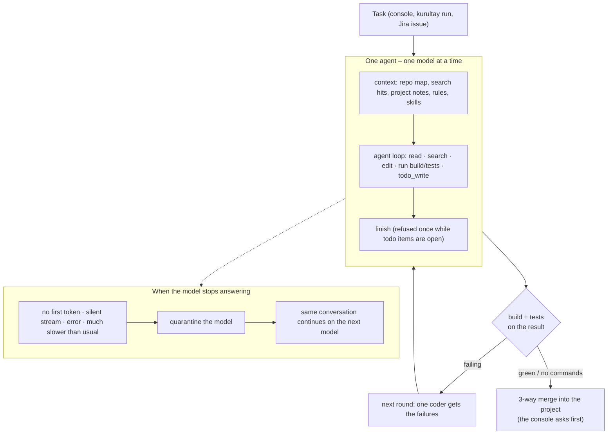

# Kurultay

**A coding agent for air-gapped networks that keeps working when a local LLM stops answering.**

Give it your OpenAI-compatible endpoints and API keys. Kurultay:

1. **Measures every model.** Context window, tool calling, JSON, speed, concurrency capacity, coding and editing accuracy are measured once, and each model gets a score per role.
2. **Indexes the project.** Symbols, the dependency graph, PageRank and a BM25 search index are built without any model. A map-reduce summarisation spread over all models in parallel then writes `ARCHITECTURE.md`, module documents, end-to-end **flow documents** (with source line references and Mermaid diagrams) and `PROJECT_NOTES.md`, which the agent reads on every task.
3. **Does the work.** One agent with **one model at a time** works the whole task through: it explores the code, edits, runs the build and tests itself and keeps the task's requirements as a **todo list**. The build and tests decide when it is done; when they fail, the failures go to a coder in the next round. There is no separate judge or reviewer model.
4. **Keeps going when a model stops answering.** A model that hangs, fails or becomes much slower than usual is quarantined, and the same conversation continues on another model from the step where it stopped.

There are **no npm runtime dependencies**. All it needs is Node.js ≥ 20: no native builds, Python, Docker, CDN or telemetry.

> The name: a *kurultay* is the assembly where decisions were taken together in the Turkic-Mongol tradition. Here, the members of the assembly are your LLMs – one speaks at a time, the others step in when it falls silent.

The console UI, reports and messages are in English; tasks and questions can be written in any language the models understand (Turkish is recognised by the question/task detection).

### Measured

On the bundled bench (Java 8 and C++17 feature tasks, hidden acceptance tests, GLM-5.3-flash as the main model):

| Run (v0.1.0) | Result |
|---|---|
| 6 feature tasks, 20 min each | **6/6 in 24.1 min** |
| The main model stops answering after 3 requests (2 tasks) | **2/2** – finished on the backup model |

Running several models at once (races, council reviews, an acceptance judge from a second model) was tried during development. In the same bench it was slower and less reliable – a second model's judge sent passing work into extra rounds until the time ran out – so it is only available on request (`--mode multi`, see [Several models at once](#several-models-at-once-opt-in)).

---

## Why?

For an offline company network a coding agent has to do more than edit code: measure an unknown set of local models, index a large C/C++/Java code base so the model finds its way, and – above all – carry on when one of the local servers hangs. Kurultay is built around exactly that.

Kurultay is written from scratch under the MIT licence and contains no code from other projects.

---

## How a task runs



1. **Context.** The agent starts with a repo map (most referenced symbols), the search hits for the task, `PROJECT_NOTES.md`, the project's rules and the skills that match the task. It explores the rest itself.
2. **Todo list.** A task with three or more requirements (list items, sentences) is turned into a checklist the agent keeps with `todo_write` (pending / in_progress / completed / dropped with a reason). `finish` is refused once while items are open; the list survives context compaction.
3. **Checks while it works.** After every edit the file goes through a compiler or LSP check; the agent runs the project's build and test commands itself (`verify` in the configuration) and is told to reproduce bugs with a failing test first.
4. **Done or not.** When the agent finishes, the build and tests run once more on the combined result in a sandbox copy. Green (or no commands configured) → the change is applied: the console asks first (unless `/auto-apply on`), `kurultay run` asks when `orchestrator.confirmMerge` is true, `--dry-run` only writes `changes.diff`. Red → the failures go to a coder in the next round, up to `orchestrator.maxIterations`.
5. **Failover.** Every request is watched by three clocks (first token, stream silence, total time) and a hedge timer. A model that misses them is quarantined; the conversation moves to the best other model whose context fits, converted to the text protocol if that model has no native tool calling. The switch is listed in `REPORT.md`.

Several models are still used in parallel where it costs the user no waiting time: the capability probe, the project analysis (`analyze`) and questions (`ask`, answered by a small council).

### Resilience

- **When a model stops answering** (hang, timeout): time to first token (180 s by default + extra time for long prompts), stream silence (90 s) and total time (10 min). A model that times out is not retried for that request; it is **quarantined** (2 min, growing up to 16 min on repeats) and no worker sends it requests.
- **When a model gets slow**: a step that takes 2.5× the model's usual time (at least 30 s) is also sent to the best other coder of similar speed; the first answer wins. After two late answers in a row the agent moves to the other model and the slow one is left out for 5 minutes (`llm.hedge`).
- **The agent fails over permanently**: the failed model is not used again for that task (`llm.stickyFailover`).
- **When the connection drops** requests are retried with exponential backoff. If every model is down, Kurultay waits up to 10 minutes and tries again (circuit breakers are reset).
- **When the server answers `429`/`503` + `Retry-After`** Kurultay waits as long as asked; `requestsPerMinute` spaces requests for rate-limited providers.
- **When the context overflows** the request goes to a model whose window fits. In long runs old tool outputs are cleared first (60% of the window), then the middle of the conversation becomes a structured hand-over note (85%).
- **Loop protection**: the same call with the same result warns on the 3rd time and stops the agent on the 5th. A-B-A-B ping-pong, long read-only exploration and consecutive failing calls are caught too.
- **Safe editing**: an existing file must be read before it is overwritten or deleted, and re-read after an edit that did not match. Bracket balance and JSON validity are checked after edits. CRLF line endings are preserved; smart quotes and dashes do not break matching; mistyped paths with a single match are corrected.
- **Models that describe tool calls in prose** are handled by a fast model that turns the text into real tool calls (toolshim). Servers without native tool calling, or that reject the `tools` field, are switched to prompt-based tool calling automatically.
- **Crash safety**: changes live in an overlay and in sandbox copies until the final merge; in-place mode is protected by a journal and the original files are restored on the next run if it was interrupted.
- **Your changes are kept**: if you edited a file while the agent was working, the result is merged 3-way. Conflicts get git-style markers and are listed in the report.
- **Truncated answers** (`finish_reason=length`): cut-off JSON or tool calls are requested once more with a larger `max_tokens`; plain text is continued where it stopped.

### Quality and speed

| Feature | What it does | Setting |
|---|---|---|
| **Compiler check after every edit** | C/C++: `-fsyntax-only` with the flags from `compile_commands.json` (headers through a translation unit that includes them). Java: `javac -sourcepath` (`tools.javaRelease: 8` enforces the Java 8 API). **LSP** diagnostics first when configured (clangd, jdtls…). Only real errors in the edited file are fed back | `tools.syntaxCheck`, `lsp` |
| **Test first** | Bugs are reproduced with a failing test first, every change leaves tests behind, existing tests are never weakened | `orchestrator.testFirst` |
| **Definitions in words** | A value the task only describes (a count, a size, what a getter returns) gets its most natural reading, pinned in a test with concrete numbers | – |
| **Isolated builds** | Build/test commands run in a copy under `.kurultay/sandboxes/sb-N` (copy-on-write clone, `node_modules` linked); the real project only changes at the merge | `tools.isolation`, `tools.sandbox` |
| **Read-ahead** | Models with a 64K+ window get up to 800 lines per `read_file` (a whole file instead of 100-line pieces), and every read names where the functions and types the code uses are defined elsewhere | `tools.readWindow`, `tools.readAhead` |
| **Few round-trips** | The agent is told to call independent tools in one step; the context lists the files of projects up to 300 files | – |
| **Long tool output to a file** | Output over 8000 characters is saved under `.kurultay/tool-output/`; the model sees the start, the end, the path and a sha256 and reads the part it needs | `tools.maxToolOutputChars` |
| **Read cache** | Re-reading the same lines of an unchanged file returns a one-line note instead of the content | `tools.readCache` |
| **Context ladder** | 60%: old tool outputs cleared (no model call); 85%: hand-off summary; above 100%: fewer recent turns kept | `llm.microcompactAt`, `llm.compactAt` |
| **Real context windows** | Without a window reported by the server, well-known families get their published window (Kimi, Qwen3: 256K; GLM: 200K; DeepSeek, gpt-oss, Mistral Large, Gemma, Llama: 128K) once the probe's 32K test passed; a context-length error lowers it | `"contextWindow"` per model |
| **Reasoning models** | At least 8K (up to 32K) output tokens; Kimi / DeepSeek / GLM / MiniMax get their `reasoning_content` back with their tool calls; short structured answers (summaries, toolshim) are asked without hidden thinking | `llm.quickStructured`, `"thinking"` per model |
| **Publisher sampling settings** | Known families get their recommended sampling (Qwen3-Coder `0.7 / 0.8 / top_k 20 / 1.05`, Devstral `0.15`, gpt-oss `1.0 / 1.0` …); hybrid Qwen3 gets `/no_think`. Servers that reject `top_k`/`min_p` are asked again without them | `llm.samplingPresets`, `"preset"` per model |
| **Edit format per model** | The probe measures `edit_file`, SEARCH/REPLACE and whole-file editing; the agent uses the best one | `tools.editFormat` |
| **Silent context cuts** | A server that cuts the prompt without an error (Ollama's `/v1`, 4K by default) is measured at its real size and you get the fix | – |
| **MCP tools trimmed** | When MCP tool declarations would take more than 1500 tokens per request, the model gets `mcp_describe` and `mcp_call` with a one-line list instead | `tools.mcpToolBudgetTokens` |
| **Learning from outcomes** | Success/failure per role (`~/.kurultay/model-stats.json`) is blended with the probe score | – |
| **Semantic search** | With an embedding model (bge, e5, nomic-embed, Qwen3-Embedding…) search fuses BM25 and cosine similarity with RRF | `embeddings` |
| **Fine-tuning data** | Every verified task saves its conversation (`sessions/<id>/trajectories.jsonl`, OpenAI chat format with tools); `kurultay trajectories` collects them for LoRA training | `orchestrator.saveTrajectories` |
| **Where the time went** | Every `REPORT.md` has a "Time" table and a per-model table of requests / tokens / latency / errors / failovers; `kurultay stats` and `/stats` | – |
| **Evaluation harness** | `kurultay eval <suite>` runs every task in a fresh copy and adds hidden tests afterwards; `--repeat N` gives pass@k and pass^k; `--score <folder>` grades another agent's work with the same tests | – |

### Several models at once (opt-in)

`--mode multi` (in the console `/mode multi`, in the configuration `orchestrator.defaultMode: "multi"`) brings back the multi-model flow of earlier versions. `race`, `council` and `split` choose one of its parts directly; `single` is the same as `auto`.

| Mode | What happens |
|---|---|
| `multi` | Planning first (short tasks skip it); one subtask → **race**, several → **split** |
| `race` | `raceWidth` candidates (the best models, sampled again when there are fewer) solve the same subtask in separate sandboxes. With build/tests the main model tries alone first and the race starts only when it fails (`cascade`). Candidates are ranked by build/test results, their rivals' reproducing tests and an anonymous review; once one passes, the others get 15% of its time |
| `council` | race + a full council review (`councilSize` reviewers) every time, three plan drafts |
| `split` | Independent subtasks run on different models at the same time; subtasks that edit the same file run one after the other |

In these modes a reviewer that did not write the code looks at the winner, blocking findings get up to two fix rounds, and models more than 3× slower than the best one stay out of the waiting steps (`orchestrator.speedBand`). The settings marked *(multi)* in the [configuration reference](#orchestrator) only matter here.

---

## Installation (air-gapped)

On a machine with internet access:

```bash
git clone https://github.com/ozknScalebor/kurultay.git
cd kurultay
npm ci            # build tools only (typescript, eslint)
npm test          # ≈380 tests – unit, integration and CLI against mock LLM servers
npm run pack:offline
```

This creates a `release/` folder:

- `kurultay-<version>.tgz`: install on the target with `npm install -g ./kurultay-<version>.tgz`. No internet needed, there are no runtime dependencies.
- `kurultay-<version>-portable-<os>-<arch>/`: for machines **without Node.js**. It contains a Node runtime; run `./kurultay` (`kurultay.cmd` on Windows). Build it on the same OS and architecture as the target.

Prebuilt packages for Linux x64 and Windows x64 are attached to every [GitHub release](https://github.com/ozknScalebor/kurultay/releases). Copy the folder to the closed network on a USB stick and you are done.

## Quick start

### Interactive console (recommended)

```bash
kurultay            # or: kurultay console --workspace /my/project
```

```
 ╦╔═╦ ╦╦═╗╦ ╦╦ ╔╦╗╔═╗╦ ╦
 ╠╩╗║ ║╠╦╝║ ║║  ║ ╠═╣╚╦╝
 ╩ ╩╚═╝╩╚═╚═╝╩═╝╩ ╩ ╩ ╩
 v0.1.1 · one agent, every local LLM as its backup · offline

LLM settings  1 endpoint (1 reachable) · 4 models · 14 parallel slots · capability profile: saved
  Endpoint
  main            http://10.0.0.11:8000/v1    4 models   ● 18 ms
  Models
  name                        context  tools   tok/s  parallel  best roles         state
  gpt-oss-120b@main           128K     native  61     8         planner, judge     ready
  devstral-small-2@main        256K     native  95     4         coder, reviewer    ready
  ...
  timeouts: first token 3 min · silence 90 s · total 10 min · pause after a hang 2 min

No project open. /workspace <path> opens one, /workspace 1 the first recent one:
  1) ~/projects/uart-driver   current folder
  2) ~/projects/gateway       last used 2026-10-21
kurultay ❯ /workspace 1
  ✓ index: 412 files, 3,180 definitions, 1,204 dependencies
  ✓ architecture analysis up to date
uart-driver ❯ Add DMA support to the UART driver
→ task: one agent works it through (/ask to only ask)

Kurultay – 4 models · session 2026-10-23T09-12-40
Planning…

Plan (single) – 1 subtask
  1. Add DMA support to the UART driver

▸ T1  Add DMA support to the UART driver  [devstral-small-2@main]
    ✓ T1-1 done – 14 steps, 3 files (devstral-small-2@main)
...
Verification: passed
3 files, +120/-4 lines. Apply to the project? [y/N] y
Applied to the project: 3 files written
```

- **On start** it shows the live state of the endpoints, the models, their measured capabilities, parallel capacity and timeout settings. Without any configuration it asks once for the endpoint URL, the API key and the model names, and writes them to `~/.kurultay/config.json` (see [Configuration](#configuration)).
- **Jira & GitLab** (when the configuration has a `jira` section): the start screen also shows whether Jira answers, which user the token belongs to, how many issues wait for `@kurultay`, the GitLab version, the branch that will be used and whether the start-up watch is on. `/jira` lists the waiting issues, `/jira run [KEY]` does them, `/jira startup` and `/jira log` – all without a workspace, since the Jira work happens in its own clone.
- **The prompt takes commands at once.** A project is opened with `/workspace <path>` (or `kurultay --workspace <path>`); `/workspace` alone lists the recent ones, `/workspace 2` opens the second. Commands that need a project say so; `/jira` needs none. When a project opens, the index is updated and changed files trigger an incremental architecture analysis (skip with Ctrl+C; `/index`, `/analyze` do it by hand).
- **The capability probe runs once, on start.** Models without a measured profile are probed right after the start screen (also before the first Jira issue), and the result is saved in `~/.kurultay/capabilities.json` for every project; later starts do not probe again. Only a model added to the configuration later is probed (on its own). `/probe` re-measures every model, `/probe <model>` one of them, `/probe --deep` measures more (bigger context, more parallel requests).
- **Typing `/` opens the command menu**; it filters as you type, ↑/↓ selects, Tab/Enter runs. Command arguments (`/mode r` → `race`), `@file` and `$skill` complete too.
- **Plain text**: a question (`where is …?`, `how does … work`, `explain …`; Turkish questions are recognised too) is answered by the models as a council and follow-up questions know the previous answers; a task goes to the agent, and you are asked before the result is applied to the project. `/ask`, `/run` or `/intent` pin the behaviour. `!command` runs a shell command.
- A running job stops with **Ctrl+C** (half-done changes are rolled back). Whatever you typed meanwhile goes to the next prompt.
- **UI**: answers and reports are rendered as Markdown (headings, lists, tables, highlighted code blocks). Below the prompt is a status line: git branch, mode, ready models, **tokens spent in this session and the context fill of the last answer**, session.
- **Token and context tracking**: during long jobs the spinner shows elapsed time, LLM requests in flight, input/output tokens spent on this job and **the fullest context right now** (e.g. `context 62% (80K/128K)`). When the job ends a one-line summary is printed (`⟡ 18 requests · 16K in / 829 out tokens · peak context 11% (1.8K/16K) (model)`). `/stats` (or `/context`, `/tokens`) shows the session totals, the last answer's context as a bar, and a per-model table of requests / tokens / mean latency / **peak context fill** / errors; `/stats reset` clears the counters.
- **Plan mode** (`/plan on`): a planner writes a plan first and shows it before any code is written; Enter or `y` approves, `n` cancels, anything else you type makes the planner revise it with your feedback.
- **Budget and resume**: when `orchestrator.maxTokens` / `maxMinutes` runs out, the job stops without touching the project. An interrupted task (budget, Ctrl+C, crash) continues from the subtask where it stopped with `/continue-run`; finished subtasks are not run again.
- **Output** is grouped by phase. Each phase starts with a heading line (`── Planning ────`, `── Coding`, `── Checks`, `── Apply`, `── Summary`) and one dim line saying what happens in it. A rule separates the output from the prompt. Retried requests (a dropped connection, a timeout that is retried) show as a dim `↻ … retrying` line instead of a warning. Tool calls, shell commands and single LLM requests only appear with `/verbose on`.
- **Live activity**: while a job runs, the rows under the spinner say what is happening now and which model does what:
  ```
  ⠧ Task · 2m 13s · 1 LLM request running · 120K↑ 8K↓ tokens · Ctrl+C to cancel
    now: T1: the agent is coding in its sandbox
    T1-1  devstral-small-2     editing CsvProductLoader.java · step 7
  ```
- **Windows window that closes at once**: on some company PCs Node always runs in a window of its own, which closes – with Kurultay's answer or error – as soon as the command ends. `kurultay --pause …` (or `setx KURULTAY_PAUSE 1` once) waits for Enter before the window closes; unexpected errors also go to `~/.kurultay/last-error.log`.
- **Old Windows consoles** (cmd.exe / PowerShell in conhost) cannot draw some symbols; Kurultay detects them and prints plain ASCII instead (`+` for ✓, `>` for →, …). Windows Terminal, VS Code and Git Bash get the Unicode version. Force it with `--ascii` or `KURULTAY_ASCII=1` (`=0` forces Unicode).
- Main commands: `/models`, `/model add|remove`, `/llm` (timeouts, `/llm set …`), `/endpoint add|remove`, `/probe`, `/workspace`, `/index`, `/analyze`, `/ask`, `/run`, `/plan`, `/continue-run`, `/stats`, `/mcp`, `/mode`, `/intent`, `/skills`, `/search`, `/map`, `/status`, `/runs`, `/report`, `/diff`, `/dry-run`, `/auto-apply`, `/verbose`, `/ui`, `/clear`, `/exit`.

#### Sessions

| Command | What it does |
|---|---|
| (automatic) | Every question and task turn is saved under `.kurultay/conversations/` |
| `/sessions` | Saved sessions (with branches and where they came from) |
| `/resume [n]`, `kurultay --continue`, `kurultay --resume <id>` | Continue a session: question history, mode, skills and other settings come back, with a recap of the last turns |
| `/history` | Turns of this session; those that changed the project are marked |
| `/rewind [turn]` | Go back to before that turn: changes that this and later tasks applied to the project are undone and the turns are removed from the conversation. Files edited by hand since then get a warning and a confirmation. From the command line: `kurultay rewind [session]` |
| `/branch [title]` | Branch the conversation here; the previous branch comes back with `/resume` |
| `/worktree new <name>` | Opens a git worktree of the project under `.kurultay/worktrees/<name>` on branch `kurultay/<name>` and switches to it. Index, analysis and capability profile are copied, not recomputed. Also `kurultay --worktree <name>` |
| `/worktree diff · merge · commit · exit · remove · list` | See the diff, merge into the main branch (with confirmation, rolled back on conflicts), return to the main repository, delete |

Before every apply, the previous content of the changed files is written to the session folder (`checkpoint.json`); rewinding uses that checkpoint. The `.kurultay/` folder is never committed (`.git/info/exclude`).

LLM settings and capability profiles are kept per user (`~/.kurultay/`; change with `KURULTAY_HOME`), so projects do not need to be re-measured. A project's `kurultay.config.json` is used when present; **if it has no endpoints** it extends the user configuration (the project only carries its build/test commands and rules).

### Command line

```bash
cd /my/project
kurultay init        # kurultay.config.json + .kurultay/rules, skills, review_rules.md templates
# edit baseUrl, apiKey and the model names in kurultay.config.json
kurultay probe       # once: capability profile → ~/.kurultay/capabilities.json (+ .kurultay/CAPABILITIES.md)
kurultay analyze     # index + summaries with all models → .kurultay/ARCHITECTURE.md
kurultay run "Add DMA support to the UART driver; existing tests must pass" --ui
```

No GPU yet, or want to try it first? Use the mock LLM server: `kurultay mock --port 9100` and give `http://127.0.0.1:9100/v1` as the endpoint.

## Commands

| Command | Description |
|---|---|
| `kurultay` / `kurultay console` | Interactive console (`--workspace <dir>`, `--no-probe`, `--no-analyze`, `--ascii`) |
| `kurultay rewind [session]` | Undo the changes a task applied to the project (default: last task; `--yes`, `--force` for files changed since) |
| `kurultay init` | Creates configuration and rule templates; guesses build/test commands (CMake, Meson, Maven, Gradle, Cargo, Go, npm, pytest, Make) |
| `kurultay probe [--model a,b] [--deep] [--quick]` | Measures the models again and saves the profile (all configured models, or only `--model`). Standard: 2 coding + 2 editing tasks, context up to 32K, 1→2→4 parallel requests. `--deep` measures up to a 256K context and 16 concurrent requests; `--quick` skips the coding benchmark; `--minimal` sends about 4 requests per model (reachability, speed, tool calling, JSON) and takes the window from the server or the model family |
| `kurultay index [--embed]` | Static index (no LLM needed); `--embed` also builds the semantic search vectors |
| `kurultay analyze [--force] [--drafts N] [--flows N]` | Parallel summaries, architecture document, `PROJECT_NOTES.md` and documents for the N most important flows (`--flows 0` turns them off). Incremental: only changed files are summarised again |
| `kurultay skills` | Lists the skills found and validates them against the specification. `skills new <name> --description "..."` creates a skill folder |
| `kurultay run "<task>"` | `--mode auto\|single\|multi\|split\|race\|council` (default `auto`: one agent), `--req requirements.md`, `--skill a,b`, `--dry-run`, `--yes`, `--ui`, `--approve-plan`, `--max-tokens N`, `--max-minutes N` |
| `kurultay run --resume [session]` | Continues an interrupted / out-of-budget task from the subtask where it stopped |
| `kurultay eval <suite>` | Quality measurement with hidden tests: `--modes single,race,council`, `--tasks a,b`, `--repeat N`, `--out <dir>`, `--keep`, `--validate` |
| `kurultay stats [--runs N]` | Per-model requests/tokens/time of the last tasks and the learned success rates |
| `kurultay trajectories [--out file]` | Collects the conversations of verified tasks into one JSONL file for fine-tuning |
| `kurultay ask "<question>"` | A question about the project; the models answer separately, a chair model merges |
| `kurultay map [--tokens N] [--focus a,b]` | Repo map (most referenced files and symbols, ranked by PageRank) |
| `kurultay search "<query>"` | Code search (BM25; BM25 + embeddings with RRF once vectors exist) |
| `kurultay status` | Models, index and recent sessions |

`--ui` opens a **live dashboard** at `http://127.0.0.1:7420` that loads nothing from outside; it shows the load of every model and the steps of every worker side by side.

## Configuration

### Where the settings live

| File | Used for |
|---|---|
| `~/.kurultay/config.json` | Your models and keys, for every project. The console writes it on the first start (it asks for the endpoint URL, the API key and the model names), or copy [`config_template.json`](config_template.json) there and fill it in. `KURULTAY_HOME` moves the folder |
| `<project>/kurultay.config.json` (or `<project>/.kurultay/config.json`) | Project settings: build/test commands, rules, tool options. **Without endpoints it extends the user file** – the project only carries what is its own. With endpoints it replaces the user file |
| `--config <file>` | An explicit file (CI, the bench); the project's own file is still merged on top of it |

The files are plain JSON (the `//` comments below are explanations only – leave them out). Any string can use environment variables: `"${JIRA_TOKEN}"` or `"${KURULTAY_API_KEY:-none}"` with a default, so keys and passwords need not be written into the file. `kurultay init` writes a project file with the build/test commands it guesses (CMake, Meson, Maven, Gradle, Cargo, Go, npm, pytest, Make).

### Starting from the template

[`config_template.json`](config_template.json) lies in the Kurultay folder (next to `kurultay.cmd` in the portable package). Copy it as your user configuration:

```bat
mkdir %USERPROFILE%\.kurultay
copy C:\kurultay\config_template.json %USERPROFILE%\.kurultay\config.json
```

(Linux: `cp config_template.json ~/.kurultay/config.json`.) It has the LLM server, the models, an optional helper model, Jira and GitLab, with a `$comment` in every section. Every value you have to enter is written as `<...>` – e.g. `"baseUrl": "<address of your LLM server, ending in /v1 – e.g. http://10.0.0.5:8000/v1>"`. Replace them and delete the sections you do not use. Until then Kurultay does not start but names what is left:

```
~/.kurultay/config.json still has values to fill in: baseUrl, apiKey, models[0], jira.url, jira.token – replace each <...> with your value, or delete a section you do not use (jira, gitlab, helper).
```

### The smallest configuration

One server, one key, a list of model names:

```jsonc
{
  "baseUrl": "http://10.0.0.11:8000/v1",
  "apiKey": "${KURULTAY_API_KEY}",
  "models": [
    "devstral-small-2",                              // the first is not special – see primaryModel
    "gpt-oss-120b",
    { "id": "glm-4.5-air", "apiKey": "another-key" }    // a model with its own key
  ],
  "orchestrator": { "primaryModel": "devstral-small-2" },   // the agent's model; the others are its backup
  "verify": { "build": "cmake --build build -j", "test": "ctest --test-dir build" }
}
```

- **`primaryModel`** picks the model the agent works with. Without it the model with the best coder score from the probe is used. The other models only take over when it stops answering (and do the analysis and `ask` in parallel).
- **`verify`** matters most: the build and tests are what decide whether a task is done. Without them the result is applied unchecked and you get a warning.
- In the console `/model add <name> [apiKey]`, `/model remove <name>`, `/endpoint add|remove` and `/llm set …` edit the user file. Examples: [`examples/kurultay.config.simple.json`](examples/kurultay.config.simple.json), [`examples/kurultay.config.full.json`](examples/kurultay.config.full.json).

### Several servers and a helper model

```jsonc
{
  "endpoints": [
    { "name": "gpu1", "baseUrl": "http://10.0.0.11:8000/v1", "apiKey": "${GPU1_API_KEY}" },
    { "name": "gpu2", "baseUrl": "http://10.0.0.12:8000/v1", "apiKey": "${GPU2_API_KEY}", "models": ["gpt-oss-120b"] }
  ],
  "helper": {                                          // a small model, e.g. llama.cpp on this PC
    "baseUrl": "http://127.0.0.1:8080/v1",             // apiKey defaults to "none"
    "models": ["gemma-3-1b-it"],
    "roles": ["fast", "summarizer"]                    // the default
  },
  "models": { "devstral-small-2@gpu1": { "primary": true } }
}
```

A model is addressed as `name@endpoint` (or just `name` when it is unique). An endpoint without `models` lists its models with `GET /models`; embedding and reranker models are left out of the coding work automatically. Helper models only do their roles – `summarizer` (summaries during the analysis) and `fast` (context compaction, turning a prose reply into a tool call); they never write code unless no other model is reachable.

### Reference

Every field is optional unless marked *required*; the defaults are what Kurultay uses without the field.

#### Endpoints (`endpoints[]`, or the top-level `baseUrl` / `apiKey` / `models`)

| Field | Default | Meaning |
|---|---|---|
| `name` | `main` | Short unique name, the part after `@` in model keys |
| `baseUrl` | *required* | OpenAI-compatible base URL, e.g. `http://10.0.0.11:8000/v1` (vLLM, llama.cpp, Ollama, LM Studio, TGI, LiteLLM, SGLang) |
| `apiKey` | – | Sent as `Authorization: Bearer …`; local servers often accept any value |
| `models` | discovered | Model ids to use; strings or `{ "id": …, "apiKey": … }` |
| `maxConcurrency` | probe decides | Most requests at the same time for this server (shared by its models). Set it only when the server or the provider plan needs a cap |
| `requestsPerMinute` | no limit | Requests are spaced to stay under a provider limit (NVIDIA NIM free tier: 40); servers with the same URL and key share it |
| `timeoutMs`, `firstTokenTimeoutMs`, `idleTimeoutMs` | from `llm` | Watchdog times for this server |
| `headers` | – | Extra HTTP headers |
| `roles`, `rolesOnly` | – | Default roles for its models; `rolesOnly: true` limits them to those roles (what `helper` sets) |
| `disabled` | `false` | Keep the entry but do not use it |

#### Models (`models` – a map keyed by `name@endpoint` or `name`)

| Field | Default | Meaning |
|---|---|---|
| `primary` | `false` | The agent's model (same as `orchestrator.primaryModel`) |
| `apiKey` | the endpoint's | Key for this model only |
| `contextWindow` | probe / server / model family | Context size in tokens (when the server reports none and the family is unknown) |
| `maxOutputTokens` | model dependent | Upper limit for one answer |
| `nativeTools` | probe | Force native tool calling on or off (off = `<tool_call>` text protocol) |
| `roles` | probe scores | Pin roles: `planner`, `coder`, `summarizer`, `reviewer`, `judge` (plan merge, architecture drafts), `fast` |
| `rolesOnly` | `false` | Use the model only for its `roles` |
| `temperature` | publisher preset or 0.2 | Sampling temperature for agent steps |
| `preset` | `true` | `false` = do not apply the publisher's recommended sampling |
| `thinking` | model dependent | Hybrid reasoning models (Qwen3): `true` keeps hidden reasoning on; otherwise `/no_think` is added |
| `extraBody` | – | Fields merged into every request body, e.g. `{"top_k": 20}` |
| `timeoutMs`, `firstTokenTimeoutMs`, `idleTimeoutMs` | from the endpoint / `llm` | Watchdog times for this model |
| `disabled` | `false` | Leave the model out |

#### `llm` – requests, watchdogs, failover

| Field | Default | Meaning |
|---|---|---|
| `firstTokenTimeoutMs` | `180000` | No first token (text, reasoning or tool call) within this time → the model counts as not answering (0 = off) |
| `prefillMsPerToken` | `2` | Extra first-token time per prompt token (long prompts need prefill time) |
| `idleTimeoutMs` | `90000` | The stream is cut after this much silence (0 = off) |
| `timeoutMs` | `600000` | Upper limit for one request |
| `timeoutRetries` | `0` | Further tries on the same model after a timeout before failing over |
| `timeoutCooldownMs` | `120000` | Quarantine of a model that timed out (doubles on repeats, at most ×8; 0 = off) |
| `stickyFailover` | `true` | The agent never goes back to a model that failed during the task |
| `hedge` | `true` | A step that takes 2.5× the model's usual time is also sent to a similar-speed model; the first answer wins, two late answers move the agent to the other model |
| `hedgeMinMs` | `30000` | Never hedge before this (2 min before the first measured step) |
| `samplingPresets` | `true` | Publisher sampling settings for known model families |
| `quickStructured` | `true` | Short structured answers (summaries, plans, localisation) are asked without hidden thinking |
| `microcompactAt` | `0.6` | Share of the usable window at which old tool outputs are cleared |
| `compactAt` | `0.85` | Share at which the middle of the conversation becomes a hand-off summary |

#### `verify` – what decides that a task is done

| Field | Default | Meaning |
|---|---|---|
| `build` | – | Build command, e.g. `cmake --build build -j`, `mvn -q -DskipTests package` |
| `test` | – | Test command, e.g. `ctest --test-dir build --output-on-failure`, `mvn -q test` |
| `lint` | – | Optional lint command |
| `timeoutMs` | `900000` | Time limit of each command |
| `fromPipeline` | `true` | With neither `build` nor `test` set, take them from the project's CI pipeline (see below) |
| `pipelineFile` | – | The pipeline file, when the project keeps it under another name (GitLab: Settings → CI/CD → CI/CD configuration file), e.g. `"ci/pipeline.yml"` |

The commands run in the project root of a sandbox copy. The agent is told to run them before it finishes; Kurultay runs them once more on the final result.

**From the CI pipeline.** When neither `build` nor `test` is configured, Kurultay reads the project's pipeline file – `.gitlab-ci.yml`, `.github/workflows/*.yml` (also `.gitea/`, `.forgejo/`), `azure-pipelines.yml`, `bitbucket-pipelines.yml`, `.drone.yml`, `.woodpecker.yml`, and YAML files in `.gitlab/`, `.gitlab/ci/`, `ci/`, `.ci/` (or the file `pipelineFile` names) – because it already says how the project is built and tested. GitLab `include:` files of the same repository are read too (`include: ci/build.yml`, `- local: …`, patterns like `ci/*.yml`, nested up to three levels); includes from other projects, templates or URLs cannot be read offline and are skipped. From its jobs and steps it takes the commands of build and test tools (Maven, Gradle, Ant, Make, CMake/CTest, Ninja, Meson, npm/yarn/pnpm, dotnet, MSBuild, Go, Cargo, pytest/tox, Bazel …):

- the pipeline's `variables` / `env` are filled in (`$MAVEN_CLI_OPTS`), the checkout folder (`$CI_PROJECT_DIR`, `$GITHUB_WORKSPACE`) becomes the project root, a `cd` before a command and `working-directory` are kept; Azure `Maven@3` / `Gradle@2` tasks become `mvn …` / `gradlew …`;
- left out: deploy, release, publish, pages, container, security-scan, lint and docs jobs; commands that push, upload, log in, use docker/kubectl/ssh/curl, or install packages (`npm ci`, `pip install`, `apt-get` – the offline PC has what it needs, or the command fails visibly); a command with a variable the pipeline does not define;
- a command that tests (`mvn test`/`verify`, `ctest`, `npm test`, `go test`, `make check` …) or runs in a test job is the test command, the others the build command (up to three each, joined with `&&`).

The console shows what it took when the workspace opens (`build/test from .gitlab-ci.yml: …`), and so does every Jira issue. `kurultay init` writes the same commands into the project file, where you can change them. Configured commands always win; `"fromPipeline": false` turns it off.

#### `orchestrator`

| Field | Default | Meaning |
|---|---|---|
| `defaultMode` | `auto` | `auto` / `single`: one agent, one model at a time. `multi`, `race`, `council`, `split`: [several models at once](#several-models-at-once-opt-in) |
| `primaryModel` | best coder | Model id or key of the agent's model |
| `maxIterations` | `4` | Most rounds per task, the first included; a round after the first gets the build/test failures |
| `maxStepsPerWorker` | `40` | Tool-call steps of one agent run |
| `maxConsecutiveErrors` | `6` | Stop an agent after this many failing tool calls in a row |
| `testFirst` | `true` | Reproduce bugs with a failing test first, leave tests behind |
| `confirmMerge` | `false` | `kurultay run` asks before applying (the console always asks unless `/auto-apply on`) |
| `approvePlan` | `false` | Show a plan and wait for approval or feedback before any code is written (`--approve-plan`, `/plan on`) |
| `maxTokens`, `maxMinutes` | `0` (no limit) | Budget of a run; when it runs out the run stops and can be continued with `run --resume` / `/continue-run` |
| `saveTrajectories` | `true` | Keep the conversation of verified tasks as fine-tuning data |
| `localize` *(multi)* | `true` | Narrow the code down to files and functions before the coders start |
| `parallelLocalize`, `fastPath`, `fastPathMaxFiles` *(multi)* | `true`, `true`, `6` | Short tasks skip planning; the localisation runs alongside the coders |
| `planDrafts` *(multi)* | `1` | Plan drafts per plan (council mode: 3) |
| `raceWidth`, `repeatModels` *(multi)* | `3`, `true` | Candidates in a race; sample the best models again when there are fewer |
| `cascade` *(multi)* | `true` | With build/tests the main model tries alone first; the race starts only when it fails |
| `crossTest` *(multi)* | `true` | Run every candidate against its rivals' reproducing tests |
| `councilSize` *(multi)* | `3` | Reviewers in council mode |
| `speedBand` *(multi)* | `3` | Models this many times slower than the best stay out of waiting steps (0 = off) |
| `raceGrace`, `raceGraceMinSeconds`, `raceGraceVerified`, `raceGraceVerifiedMinSeconds` *(multi)* | `0.5`, `90`, `0.15`, `15` | How long slower candidates may go on after the first one is done |

#### `tools` – what the agent may do

| Field | Default | Meaning |
|---|---|---|
| `allowCommands` | `true` | `false` disables shell commands entirely |
| `commandTimeoutMs` | `600000` | Time limit of one command |
| `commandPolicy` | `deny` | `deny`: refuse `denyPatterns`; `allow`: every `&&`/`|`/`;` segment must match the allow-list (`allowPatterns` extends it) |
| `denyPatterns` | `rm -rf /`, `mkfs`, `dd if=`, fork bomb, `shutdown`, `reboot`, `git push`, `curl … \| sh` | Regexes of refused commands |
| `scrubEnv`, `envPassthrough` | `true`, – | Variables that look secret (`*KEY*`, `*TOKEN*`, `*SECRET*`, `*PASSWORD*` …) are not passed to commands; list exceptions |
| `osSandbox`, `osSandboxNetwork`, `osSandboxWritable` | `off`, `false`, – | Linux: `auto`/`bwrap` runs commands in bubblewrap – read-only system, only the sandbox copy and `/tmp` writable, no network |
| `isolation` | `sandbox` | `sandbox`: commands run in per-agent copies (`sandbox.size`, `sandbox.exclude`, `sandbox.link`); `inplace`: in the real tree, one at a time (reuses existing build folders) |
| `syntaxCheck` | `auto` | Compiler check after every edit (C/C++, Java); `off`, or a map like `{".py": "python -m py_compile {file}"}` |
| `javaRelease` | – | `javac --release N` in the check (e.g. `8` for Java 8 projects) |
| `requireReadBeforeEdit` | `true` | An existing file must be read before it is edited, overwritten or deleted |
| `editFormat` | measured per model | Force `tool`, `search_replace` or `whole` |
| `readWindow`, `readAhead` | `100` (`800` for 64K+ windows), `true` | Lines per `read_file`; name the definitions the shown code uses |
| `maxToolOutputChars`, `toolOutputPreviewChars` | `8000`, `4000` | Longer output goes to `.kurultay/tool-output/`; the model sees this much of it |
| `readCache` | `true` | Re-reads of unchanged lines return a short note |
| `mcpToolBudgetTokens` | `1500` | Above this, MCP tools are offered through `mcp_describe` / `mcp_call` |

#### `index`, `embeddings`, `skills`, `mcp`, `lsp`

| Field | Default | Meaning |
|---|---|---|
| `index.include`, `index.exclude` | all tracked files, minus build folders | Glob patterns of files to index |
| `index.maxFileBytes` | `524288` | Larger files are not indexed |
| `index.repoMapTokens` | `2048` | Size of the repo map in the agent's context |
| `index.summaryLanguage` | `en` | Language of the generated summaries and documents (`tr`/`en`) |
| `embeddings.mode`, `endpoint`, `model` | `auto` | Use an embedding model when an endpoint lists one (`off`: BM25 only) |
| `skills.paths`, `disabled`, `includeUser`, `maxPreload` | –, –, `true`, `3` | Extra skill folders, skills to ignore, read `~/.agents/skills` etc., most skills preloaded per agent |
| `mcp.servers` | – | stdio MCP servers: `{"jira": {"command": "node", "args": ["jira-mcp.js"], "readOnlyTools": ["search"]}}`; their tools appear as `mcp__<server>__<tool>` |
| `lsp.servers` | – | `{"clangd": {"command": "clangd", "extensions": [".c", ".cpp", ".h", ".hpp"]}}`; diagnostics after every edit, the compiler check takes over when it cannot start |
| `language` | `en` | Console language |
| `stateDir` | `.kurultay` | Per-project state folder (never committed: it is added to `.git/info/exclude`) |

`jira` and `gitlab` are described in [Jira → merge request](#jira--merge-request).

## Jira → merge request

Issues **assigned to you** whose **description mentions `@kurultay`** (optionally with the repository: `@kurultay{repo:https://gitlab.company.local/team/app.git}`) are done by Kurultay and come back as a GitLab merge request; the merge request link is written under the issue as a comment. Works with Jira Server / Data Center (REST API v2, e.g. 8.x and later) and Jira Cloud, and with GitLab over HTTPS.

```jsonc
// ~/.kurultay/config.json (next to the models)
"jira": {
  "url": "https://jira.company.local",
  "token": "${JIRA_TOKEN}",            // personal access token (Server / Data Center 8.14+) …
  "intervalMinutes": 5,                // watch mode: a new look at Jira every 5 minutes
  "pollSeconds": 30,                   // the issue being worked on is read again every 30 s
  "maxWaitMinutes": 120                // no model answers: keep trying this long, then the next issue
},
"gitlab": {
  "repo": "https://gitlab.company.local/team/app.git",   // optional when issues say @kurultay{repo:<url>}
  "username": "user.name",
  "token": "${GITLAB_TOKEN}",          // scope "api": push and merge request through the API
  "branchPrefix": "feature/"           // branch = prefix + issue key → feature/ABC-12
}
```

| Command | What it does |
|---|---|
| `kurultay jira` | Looks once: every waiting issue is done one after another |
| `kurultay jira --watch` | Looks again every `intervalMinutes` (log: `~/.kurultay/jira.log`) |
| `kurultay jira startup` | Starts `kurultay jira --watch` when you log in (Windows: a `.cmd` in the Startup folder; Linux: an autostart entry); `--remove` takes it out |
| `kurultay jira --dry-run` | Only lists the issues it would do and the repository of each |
| `kurultay jira --issue ABC-12` | Only this issue (also when it was done before) |
| Console: `/jira`, `/jira run [KEY]`, `/jira startup`, `/jira log` | The same from the interactive console; its start screen shows the Jira and GitLab connection |

### On screen

`/jira run` (and `kurultay jira`) shows every issue under a heading of its own – the key and the summary – with labelled lines and every step of the agent; the console adds its live activity block (model, step, Ctrl+C):

```
── YNAVYS-3883 ──────────────────────────────────────────────────────────
Silah Muhimmat > Atesleme Bilgileri ekranindaki SARP-35 bilgileri ...
  repo     https://gitlab.company.local/yna/gui/vys-gui-krh.git
  branch   kurultay/YNAVYS-3883 → dev (new)
  project  C:\Users\me\.kurultay\projects\yna_gui_vys-gui-krh
  skills   ekran-tablosu
  test     mvn -B verify (from .gitlab-ci.yml)
  analysis the project's analysis is up to date (dev)
   0:12  step 1 · looking at the repository map
   0:40  step 2 · reading AteslemeBilgileriPanel.java
   2:10  still working · waiting for Qwen3.8-Flash-Next-FP8 for 1m 30s
   3:05  step 3 · editing AteslemeBilgileriPanel.java
   4:20  build/tests: passed
  ✓ merge request opened: https://gitlab.company.local/.../merge_requests/41
── Done ─────────────────────────────────────────────────────────────────
  ✓ YNAVYS-3883    merge-request  https://gitlab.company.local/.../merge_requests/41
```

Headings and labels are cyan, times gray, step numbers magenta, warnings yellow (no dim text: a classic Windows console shows it as plain text). After a quiet minute a line says what Kurultay waits for; an outage is one line, not one per retry. Long lines wrap. `~/.kurultay/jira.log` has the same lines in plain text, each with the issue key.

### What happens per issue

1. **Find.** The built-in query is `assignee = currentUser() AND description ~ "kurultay" AND statusCategory != Done`; only issues whose description really contains `@kurultay` are taken.
2. **Repository.** Written with the mention in the description – `@kurultay{repo:<url>}` (also `@kurultay{repo: https://…}`, in quotes, or a pasted Jira link `[…|https://…]`) – or as a line `repo: <url>`; else `jira.repos` by project key, else `gitlab.repo`. With every issue naming its repository, `gitlab.repo` is not needed at all; an issue without one gets a comment saying how to name it. The setting is not part of the task text. It is cloned once into `~/.kurultay/jira-work/<repo>` and fetched later. Submodules are checked out in every issue's work tree at the commits its branch wants (recursively, with the same credentials – submodules on the same server need nothing more); one that cannot be fetched is reported and the work goes on without it. Changes the agent makes inside a submodule are not committed (they belong to the submodule's own repository) and are reported. Every issue gets a **work tree of its own** next to it (`~/.kurultay/jira-work/<repo>.issues/ABC-12`, a git worktree – the clone's objects are shared): its changes, session and todo list stay there while other issues are worked on. The index, the analysis, skills and rules come from the repository's project folder (step 4).
3. **Branch.** `gitlab.branchPrefix` + the issue key (`kurultay/ABC-12` by default, `feature/ABC-12` with `"feature/"`; a `{key}` in the prefix marks where the key goes, e.g. `"feature/{key}-ai"`). A new issue starts from the target branch (`gitlab.targetBranch`, default the repository's default branch); an issue whose branch is already on the server goes on from there. A prefix git would refuse is reported at start.
4. **Analysis – per repository, not per issue.** The repository's analysis (file summaries, `ARCHITECTURE.md`, flows, project notes) is made in the shared clone at the target branch and kept in its **project folder** `~/.kurultay/projects/<group_project>/`, with the index, skills and rules. The first issue of a repository analyses it once. Every later issue fetches first: when files changed on the target branch, only their summaries are made again (`reanalyzeFiles`, default 30 changed files, makes the whole analysis again); with nothing changed the analysis is used as it is. What an issue changes on its own branch never goes into it. Every issue's work tree starts from the project folder.
5. **Work.** Kurultay works on the summary and description of the issue, and on the comments that mention `@kurultay`, with the project's own `kurultay.config.json` (build/test commands, rules). Meanwhile it reads the issue again every `pollSeconds` (30 s): see [Changing the request](#changing-the-request).
6. **Merge request.** Commit, push and a merge request from the branch to the target branch – through the API with `gitlab.token`, otherwise with GitLab push options (git access is enough). A failing build or test still opens the merge request; its description and the comment say `FAILED`.
7. **Comment** (and, with `jira.transition`, the issue is moved, e.g. to `"In Review"`).

| Outcome | Comment under the issue |
|---|---|
| Merge request opened / updated | The merge request link, branch → target branch, build/test result (`passed`, `FAILED`, `not run`), status and changed files |
| No change produced | That Kurultay worked on it without a change, and that editing the description or an `@kurultay` comment hands it over again |
| No model answers for `maxWaitMinutes` | That the issue is paused, the work so far is kept and goes on later (written once per pause) |
| No repository for the project | Which settings name a repository |
| Error (clone, push, merge request, models) | The error message, with passwords and tokens masked |

An issue is done once; `"comment": false` turns the comments off. Kurultay's own comments never count as requests.

### Changing the request

There are two ways to change or add to the request, both while Kurultay is working and after the merge request:

- **A comment that mentions `@kurultay`** – e.g. `@kurultay also reject negative values`. Recommended: the description stays the definition of the issue, and the comments show what was asked when.
- **Editing the description.** Kurultay takes the lines that are new or changed and the ones that are gone, not the whole text again.

| When | What Kurultay does |
|---|---|
| While it works on the issue | The change reaches the running agent within `pollSeconds` (30 s): at its next step it reads "the user changed the request", follows the new text from then on and updates its todo list. An agent that was just finishing is told it is not done yet. A change that comes after the agent finished gets one more run before the commit |
| After the merge request | The issue is taken again on the next look. The work goes on **on the same branch, on top of the earlier commits** (no force push): the agent is told the earlier work is on the branch and only the new request is to be done. A new commit, the merge request is updated, and the comment lists what was done on request |

### When no model answers

The agent first moves to another model (see [Resilience](#resilience)). When none answers, Kurultay does not give up: it keeps trying – after a few seconds at first, then at most every `retryMinutes` (5) – for `maxWaitMinutes` (120). Then it writes under the issue that the work is paused, goes on with the next issue, and takes this one again on the next look; in watch mode the assigned issues keep coming round this way.

Paused work goes on **from where it stopped**, not from the beginning. After every agent step Kurultay saves what was done so far – the changed files, the todo list and the agent's last note – in `~/.kurultay/jira-progress/ABC-12.json`. When the issue is taken again, the files are put back into its work tree and the agent is told where the earlier attempt stopped, which items of its todo list were done and what it was doing. The same holds when Kurultay or the PC is stopped in the middle of an issue (Ctrl+C, shutdown): the next start goes on with it. The saved progress is removed once the work is pushed.

### Settings

| `jira.` | Default | Meaning |
|---|---|---|
| `url` | *required* | `https://jira.company.local` or `https://company.atlassian.net` |
| `token` | – | Server / Data Center: personal access token (sent as Bearer). Cloud: API token, with the e-mail address as `username` |
| `username`, `password` | – | User name and password instead of a token |
| `mention` | `@kurultay` | The word in the description that hands an issue to Kurultay; in a comment it asks for more |
| `jql` | assigned to you, mention, not done | Replaces the built-in query |
| `intervalMinutes` | `5` | Minutes between two looks in watch mode |
| `pollSeconds` | `30` | Seconds between two looks at the issue being worked on (a changed description or a new `@kurultay` comment reaches the running work) |
| `maxWaitMinutes` | `120` | When no model answers: minutes to keep trying before the issue is paused (comment, next issue, again on a later look) |
| `retryMinutes` | `5` | Longest pause between two tries while no model answers |
| `analyze` | `true` | Analyse each repository once (first issue) and keep it up to date |
| `reanalyzeFiles` | `30` | Make the whole analysis again when this many files changed on the target branch (fewer: only their summaries) |
| `repos` | – | Project key → repository URL, `"*"` for any other project |
| `comment` | `true` | Write the result as a comment |
| `transition` | – | Move the issue to this status or transition after the merge request |

| `gitlab.` | Default | Meaning |
|---|---|---|
| `repo` | – | Repository the work is done in – optional: an issue's `@kurultay{repo:<url>}` (or `jira.repos`) comes first |
| `branchPrefix` | `kurultay/` | Prefix of the branch, joined with the issue key; `{key}` marks where the key goes |
| `targetBranch` | default branch | Branch the merge request targets |
| `token` | – | Personal access token (scope `api`): used for git over HTTPS and for the merge request API |
| `username`, `password` | – | Git over HTTPS without a token (accounts with 2FA or SSO need a token) |
| `url` | from the repository URL | GitLab base URL, when GitLab runs under a path |
| `workDir` | `~/.kurultay/jira-work` | Where the repositories are cloned (and the work tree of each issue is kept) |

### Notes

- **Mention as plain text:** typing `@` in a Jira description opens the user picker. When a user named "kurultay" exists and is picked, Jira stores `[~kurultay]` instead of `@kurultay` and the issue is not taken – close the picker with Esc so the text stays plain (or set another `mention`).
- **Build and tests:** when the repository has a CI pipeline (`.gitlab-ci.yml` …), its build and test commands are used (see [`verify`](#verify--what-decides-that-a-task-is-done)). Without a pipeline and without `verify` in the project's `kurultay.config.json` the work is applied unchecked and the comment says `build/tests: not run`.
- **Passwords and tokens:** use `${ENV_VAR}` as above (`setx JIRA_TOKEN "…"` on Windows). Git gets them from an inline credential helper – never written to disk or into the remote URL – and they are masked in messages and comments.
- **Company certificates:** the portable package starts Node with `--use-system-ca`, so certificates in the Windows (or system) store are trusted for Jira, GitLab and the model servers. With your own Node.js start it the same way (`node --use-system-ca bin\kurultay.js …`, Node 22.15 or later); `kurultay jira startup` keeps the flag in the start-up entry. Otherwise set `NODE_EXTRA_CA_CERTS=C:\path\company-ca.pem`. Git uses its own setting (`git config --global http.sslCAInfo …`).
- **First try:** in the console `/jira` (lists, changes nothing), then `/jira run ABC-12`; or from the command line `kurultay jira --dry-run`, `kurultay jira --issue ABC-12`, then `kurultay jira startup`.

## SWE-bench

Patches are generated and graded in separate steps, so the agents can run on the offline machine and the grading (Docker, about 120 GB of images) on any x86_64 machine with internet access.

```bash
# 1. machine with internet: dataset → JSONL, one checkout per instance at its base commit
python -c "from datasets import load_dataset; load_dataset('princeton-nlp/SWE-bench_Verified', split='test').to_json('verified.jsonl')"
kurultay swebench prepare verified.jsonl --dir swe --sample 50 --seed 42      # or --instances a,b
#    copy swe/ to the offline machine (once for every agent you compare: swe-kurultay, swe-other …)

# 2. offline machine: Kurultay → predictions-kurultay-<version>.jsonl (resumable, runs-*.jsonl has time/requests)
kurultay swebench run --dir swe-kurultay --timeout 30

#    another agent on the same checkouts with the same prompts (prompts/<id>.txt), then:
kurultay swebench collect --dir swe-other --name other-agent

# 3. machine with Docker: the official harness
pip install swebench
swebench eval verified -p predictions-kurultay-0.1.1.jsonl --run-id kurultay -j 6
swebench eval verified -p predictions-other-agent.jsonl --run-id other-agent -j 6
```

**Grading on GitHub instead:** put the predictions under `benchmarks/swebench/<run>/` (see its README) and push – the `swebench` workflow grades them with the official harness, commits `results-*.json` and `RESULTS.md`, and adds the table to the latest release's notes. Run the workflow by hand without a folder for a smoke test with the reference patches.

Patches never contain agent state folders (`.kurultay` and those of other agents) and, by default, no test files: the harness applies its own test patch afterwards and an edited test file would stop it from applying (`--keep-tests` keeps them). Any dataset with `instance_id`, `repo`, `base_commit` and `problem_statement` works – SWE-bench Lite, Verified or Multilingual (Java, C/C++ and others).

## Bench

The `bench` workflow (Actions → bench, and automatically after every release) runs the K tasks of `samples/evals/java-envanter` and `cpp-telemetri` and scores them with the same hidden tests; it can run a second, reference agent on the same tasks for comparison. Secrets: `ZAI_API_KEY` (Z.AI GLM, the main model) and `NVIDIA_API_KEY` (free key from build.nvidia.com, the second model family). The repository variable `ZAI_BASE_URL` selects the Z.AI endpoint (default `https://api.z.ai/api/paas/v4`; the GLM Coding Plan uses `https://api.z.ai/api/coding/paas/v4`). Without `ZAI_API_KEY` a NIM model is the main model. Kurultay works with GLM; a NIM model of another family and a small helper are its backup.

Workflow inputs:

| Input | What it does |
|---|---|
| `quick` | One small C++ and one small Java task, 5 minutes per agent – checks the setup before a full run |
| `fault` = `hang` / `error`, `fault_after` | Fault test: a proxy makes the main model stop answering (or answer 503) after N requests in every run; Kurultay has to finish on its backup models |
| `repeat` | Runs every task N times (rows `K3-iade #1`, `#2` …) to tell flaky results from real ones |
| `agents` | Which agents run (comma separated); `solo` is Kurultay with the main model alone and no backup models |
| `minutes`, `tasks`, `model`, `second` | Wall-clock budget per agent and task (default 20), task subset, model overrides |

Every run gets a fresh copy of the project, the same task text and the same wall-clock budget, and the run order is rotated per task. The table reports time, requests, tokens and rate-limit waits; the log shows the models used, the project's own checks and the failing lines of the hidden tests. Results go to `benchmarks/bench/` and into the latest release's notes.

## Rules and skills

| File | Use |
|---|---|
| `.kurultay/rules/*.md` | Rules given to every worker. With `applies_to: "*.java"` (or `globs: ["*.c", "*.h"]`) in the front matter they only apply to matching files |
| `AGENTS.md`, `CLAUDE.md`, `.cursorrules`, `.clinerules/`, `.github/copilot-instructions.md` | Rule files written for other coding tools are read as they are. An `AGENTS.md`/`CLAUDE.md` in a subfolder only applies to files in that folder |
| `review_rules.md` or `.kurultay/review_rules.md` | Mandatory rules for the reviewers of `--mode multi` |
| `.kurultay/PROJECT_NOTES.md` | Generated by `analyze`, editable by hand: commands, code conventions, completion checklist, pitfalls. Added to the context of every task |

### Skills ([Agent Skills](https://agentskills.io) compatible)

A skill is a folder that describes how to do a piece of work: `SKILL.md` (with `name` + `description` in the front matter) and optional `references/`, `scripts/`, `assets/`.

```
.kurultay/skills/add-new-driver/
├── SKILL.md
└── references/interface-rules.md
```

```markdown
---
name: add-new-driver
description: Steps for adding a new hardware driver. Use it for driver work.
keywords: [driver, sürücü]        # preloaded when the task mentions them
paths: ["src/drivers/**"]         # suggested only while working on these files
# always: true                    # preload for every worker
# disable-model-invocation: true  # only via --skill or $name
---
1. ...
```

- **Jira work**: a repository's own skill folders (committed in it) are used, plus the project folder `~/.kurultay/projects/<group_project>/skills/` – put skills there that belong to the repository but not into it (the issue header shows the folder and the skills found). `~/.kurultay/skills` holds skills for every project. Rules work the same way (`~/.kurultay/projects/<group_project>/rules/*.md`).
- **Where they are read from**: `.kurultay/skills`, `.agents/skills`, `.claude/skills`, `.codex/skills`, `.qwen/skills`, `.goose/skills`, `.opencode/skills`, `.github/skills`, `skills/`, `~/.agents/skills` and `~/.claude/skills` in the home directory, plus `skills.paths`. Skills written for other agents work as they are. Old single-file `.md` skills are supported too.
- **Progressive loading**: models first get only a list of names + descriptions; when needed a model opens the body with the `skill` tool and extra files with `skill_file`. Context is not wasted on small local models.
- **Selection priority**: `--skill a,b` and `$name` in the task text > `always` > `keywords` > skills a planner assigned to the subtask (`--mode multi`). Lexically related ones are marked as "suggested". Skills with `paths` are announced when a worker touches those files.
- **Report**: which worker used which skill and why is listed in `REPORT.md`. `kurultay skills` validates the name/description rules.


## Generated files (`.kurultay/`)

```
CAPABILITIES.md                      readable copy of the capability profile (the profile itself: ~/.kurultay/capabilities.json)
index/index.json                     symbols, graph, PageRank, summaries (incremental)
index/vectors.json                   embedding vectors per code chunk (when an embedding model exists)
ARCHITECTURE.md, INDEX.md            architecture summary and file index
modules/*.md                         module documents
flows/NN-*.md                        end-to-end flow documents (steps, source lines, Mermaid)
PROJECT_NOTES.md                     project notes the agents read on every task
skills/<name>/SKILL.md               project skills
sandboxes/sb-N/                      per-worker build/test copies
sessions/<id>/                       plan.json, events.jsonl, session.json, changes.diff, REPORT.md, trajectories.jsonl (verified runs)
```

## Security

- Agents can only read and write files inside the project root. `.git` and `.kurultay` are protected.
- Commands are filtered by `tools.denyPatterns`. By default commands such as `rm -rf /`, `mkfs`, `dd`, `git push` and `curl | sh` are refused. With `tools.commandPolicy: "allow"` only allow-listed commands run (every `&&`, `|`, `;` segment is checked separately; `$(…)` and redirection outside the project are refused). `tools.allowCommands: false` disables commands entirely.
- Environment variables holding API keys, tokens and passwords are not passed to model commands (`tools.scrubEnv`, exceptions in `tools.envPassthrough`).
- On Linux, `tools.osSandbox: "auto"` runs commands inside bubblewrap: read-only system, only the worker's sandbox copy and `/tmp` writable, no network.
- Commands run in per-worker sandbox copies; only the approved merge writes to the real project.
- With `confirmMerge: true` you are asked before changes are applied to the project. With `--dry-run` the result is left as `changes.diff` only.

## Using it as a library

```ts
import { createApp, loadOrBuildIndex, Orchestrator } from 'kurultay';
const app = await createApp({ root: '/my/project' });
const { index } = loadOrBuildIndex(app);
const report = await new Orchestrator(app.root, app.config, app.router, app.materializer, index, app.bus)
  .run('Task text', { mode: 'race' });
```

## Sample projects and task suites

[`samples/`](samples/) contains two medium-sized, deliberately buggy projects for trying Kurultay with your own models:
a **Java 8 inventory/order** system (dependency-free `Build.java`, a JDK is enough) and a **C++17 telemetry** library (CMake + CTest, ASan/UBSan).
Each has 8 bug and 2 feature tasks ([java](samples/java-envanter/GOREVLER.md), [c++](samples/cpp-telemetri/GOREVLER.md), written in Turkish as user reports), hidden acceptance tests and reference solutions:

```bash
kurultay eval samples/evals/java-envanter --modes single,race,council
kurultay eval samples/evals/cpp-telemetri --validate
```

## Limitations and roadmap

- The symbol extractor is regex/heuristic based so that no native build is needed (C, C++, Java, Kotlin, C#, Python, JS/TS, Go, Rust). An LSP server can be connected for precise diagnostics; optional `web-tree-sitter` (WASM) is on the roadmap.
- **No IDE plug-in** (VS Code/JetBrains). Kurultay works as a terminal console, CLI, web dashboard and library; IDE integration was deliberately left out of scope.
- The MCP client supports only the stdio transport and tools (`tools/*`); no resources, prompts or HTTP transport.
- OS-level command isolation (bubblewrap) is Linux-only; on Windows/macOS sandbox copies + the command policy are used.
- With local models, quality is bounded by the models themselves: Kurultay keeps the work going and checks it with your build and tests, but it cannot make a weak model solve a task it cannot solve. A red result is `incomplete` and the report shows the failing checks. `kurultay eval` measures your models (and `--mode multi` against the default) on your own task suites.

## Development and tests

```bash
npm ci
npm test                  # unit + integration + CLI (≈380 tests)
npm run lint              # ESLint (floating promises, unused code, unsafe patterns)
npm run test:unit         # unit tests only
npm run test:integration  # integration against mock multi-model LLM servers
npm run test:cli          # runs the real CLI end to end as a child process
npm run test:package      # offline packaging + install without internet + portable launcher
npm run test:coverage     # coverage thresholds: lines ≥ 96%, branches ≥ 88%, functions ≥ 94%
```

| Layer | What is tested |
|---|---|
| `test/unit` | Sandbox pool (parallelism proven with a barrier), compiler check (gcc/clang/javac, compile_commands, Windows paths), command policy and environment scrubbing, learned model statistics and the json_schema fallback, console usage meter; checkpoints, conversation storage, Markdown renderer, status line and activity indicator, git helpers; console plumbing (key parsing, bracketed paste, line editor, history, suggestion menu, line wrapping, screen), router (selection, retry, circuit breaker, first-token / silence timeouts and quarantine, auth/context errors, recovery wait, timeouts, cancellation, concurrency limit), OpenAI client (SSE, reasoning, tool-call deltas, error classification, headers), tools and security (path escapes, denied commands, read-only), overlay / 3-way merge / crash recovery, edit parsers, symbol extraction for 9 languages, import resolution, scanner, index, council (anonymity, independent reviewer, no self-votes, test evidence first, P0–P3 priority, text ranking fallback), planner, verification, configuration, skill discovery/validation/selection, front matter, loop guard, syntax check, read-before-write guard, CRLF/Unicode editing, Retry-After, folder-scoped rules |
| `test/integration` | Evaluation harness, plan approval / budget / resume, MCP and LSP (with fake servers), semantic search (fake embeddings), context budget and truncation recovery; interactive console (session storage, resume, branching, rewind, git worktree; LLM panel, start without a workspace and `/workspace`, automatic index/probe/analysis, the Jira display, question vs. task, confirmation, settings and endpoint editing, completion, Ctrl+C, token/context display), agent loop (native/text/XML tool calls, rejected tools, toolshim, permanent failover from a hung model with history conversion, idling, step limit, loop/error stop, skill preloading and tool loading, condenser and its fallback, model dropouts), orchestrator (split + dependencies, iterations, build fixing, independent re-review of fixes, conflicts, confirmation, rules, crash recovery, cancellation), probe (ladder, embedding filter, unreachable endpoints), analysis (batches, fault tolerance, incrementality), dashboard and terminal |
| `test/cli` | console (over a pipe), `init`, `probe`, `index`, `analyze` (flow documents, project notes), `skills`, `run` (`--skill`, `--req`, `--approve-plan`, `--max-tokens`, `--resume`), `ask`, `map`, `search`, `status`, `stats`; exit codes and error messages |
| `test/package` | `npm pack` contents, installation without a registry, portable bundle with an embedded Node |

### CI pipeline (`.github/workflows/ci.yml`)

```
static checks (types, ESLint, package contents) ─┬─ unit         (Linux/Windows × Node 20/22)
                                                 ├─ integration  (Linux/Windows × Node 20/22)
                                                 ├─ CLI          (Linux/Windows)     
                                                 └─ sample projects (JDK 8 + GCC: 20 tasks --validate)
                                                        └─┬─ coverage gate
                                                          └─ offline packages (Linux/Windows → artifacts)
                                                                └─ release (GitHub Release)
```

**Cutting a release:** push a tag such as `v0.3.1`, or bump the version in `package.json` and push to `main` with `[release]` in the commit message. Once all tests pass, the Linux/Windows offline packages are attached to the GitHub Release.

Failing tests show up on GitHub as error annotations; result and coverage tables appear in the job summary.

Licence: MIT
