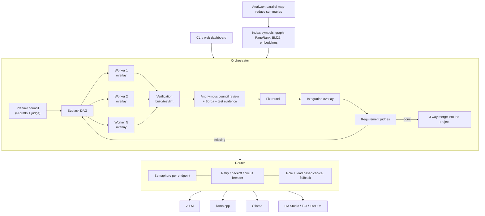

# Kurultay

**A coding agent for air-gapped networks that uses all of your local LLMs at the same time.**

Given your OpenAI-compatible endpoints and API keys, Kurultay:

1. **Measures every model.** Context window, tool calling, JSON, speed, concurrency capacity, coding and editing accuracy are measured, and each model gets a score per role.
2. **Indexes the project.** It extracts symbols, the dependency graph, PageRank and a BM25 search index. Then a map-reduce summarisation **spread over all models in parallel** produces `ARCHITECTURE.md`, module documents, end-to-end **flow documents** (DeepWiki style, with source line references and Mermaid diagrams) and `PROJECT_NOTES.md`, which the agents read on every task.
3. **Does the work.** A council of models drafts the plan. Subtasks are distributed to the models **concurrently**; on critical work several models race. Every candidate is verified with build/test, candidates are ranked by an **anonymous council review**, and finally a requirement check runs; if something is missing, the loop continues.

There are **no npm runtime dependencies**. All it needs is Node.js ≥ 20: no native builds, Python, Docker, CDN or telemetry.

> The name: a *kurultay* is the assembly where decisions were taken together in the Turkic-Mongol tradition. Here, the members of the assembly are your LLMs.

The console UI and generated reports are in Turkish.

---

## Why?

Fifteen open-source agents were studied before this project. None of them distributed the same work to all local models concurrently and merged the results with tests and cross-review. They either worked by role (one model per agent) or started parallel instances that knew nothing about each other. Kurultay fills that gap and combines the best ideas of the projects it studied:

| Idea | Source project | In Kurultay |
|---|---|---|
| Tree-sitter + PageRank repo map | Aider | `src/index/*` – dependency-free symbol extractor, reference graph, personalised PageRank |
| Architect / editor split | Aider | Planner and coder roles, model choice by role score |
| Role-based model routing + fallback chain | omp, oh-my-openagent | `Router` – role score × load × reliability; automatic fallback model |
| Robust hash/anchor based editing | omp | `edits.ts` – exact → whitespace-tolerant → indentation-tolerant matching, "closest match" hint |
| Minimal, extensible core | Pi (pi-mono) | Small modules; also usable as a library (`import { Orchestrator } from 'kurultay'`) |
| Sisyphus orchestration / TODO tracking | oh-my-openagent | Plan DAG, parallel execution in dependency order, iteration loop |
| Parallel agent isolation with git worktrees | Kilo Code, Cline | **Copy-on-write overlays**: lighter than worktrees, no repository copy, 3-way merge |
| LSP / symbol-level navigation | Serena, Crush | `find_symbol`, `repo_map`, dependent-file tools; optional LSP diagnostics |
| Hierarchical wiki / architecture document | DeepWiki-Open | File → module → architecture summaries, deterministic Mermaid module graph |
| LLM council (anonymous peer ranking + chair) | karpathy/llm-council | Council for the plan, the architecture document, code review and `ask` |
| Prompt-based tool calling fallback | OpenHands, Goose (toolshim) | Models without native tools work with `<tool_call>`, Qwen3-Coder XML or SEARCH/REPLACE |
| Context condenser, event sourcing | OpenHands | History is summarised in long sessions; every event goes to `events.jsonl` |
| Reading other agents' rule files | omp | `AGENTS.md`, `CLAUDE.md`, `.cursorrules`, `.clinerules/`, `.github/copilot-instructions.md` |
| Plan → act flow, headless mode | Cline, Qwen Code | `run` plans and applies in one go; runs non-interactively in CI |

For licensing reasons **no code was copied from any project**; the ideas were rewritten from scratch under the MIT licence. The FSL-licensed Crush was studied as a source of ideas only.

---

## Architecture



### How are all models used at the same time?

| Stage | Concurrency |
|---|---|
| `probe` | All endpoints are probed in parallel. Each endpoint gets a throughput ramp with 1→2→4→8 requests and the best concurrency level is recorded. |
| `analyze` | File batches are summarised with as many parallel requests as **all models' slots combined**; faster models take more work (load-aware router). For the architecture document N models write independent drafts and a judge merges them. |
| Planning | The best 3 planners draft in parallel, a judge merges. |
| Execution | **split**: independent subtasks run on different models at the same time. **race**: N models race on the same subtask. **council**: race + a full council review every time. **auto**: race for a single subtask, split for several (critical ones with 2 models). |
| Review | All reviewers run in parallel; candidates are anonymised as A/B/C and shuffled. A model never reviews its own code (not at all with one candidate; in a council it cannot vote for its own candidate); fixes are re-reviewed by a model that did not write them. |
| Requirement check | 2 judges decide in parallel; both must say "done". |

### Resilience

- **When a model stops answering** (hang, timeout): every request is watched by three clocks — time to first token (180 s by default + extra time for long prompts), stream silence (90 s) and total time (10 min). A model that times out is not retried for that request; it is **quarantined** (2 min, growing up to 16 min on repeats) and no worker sends it requests.
- **Workers fail over permanently**: if the model running a task drops out, the task continues where it stopped on the best fallback model whose context fits; the failed model is not used again for that task. If the fallback has no native tool calling, the conversation history is converted to the text protocol. Switches are listed in the report.
- **When the connection drops** requests are retried with exponential backoff. If every model is down, Kurultay waits up to 10 minutes and tries again (circuit breakers are reset).
- **When the context overflows** the request is routed to models whose window fits the prompt. In long runs the condenser first trims old tool output, then turns the history into a structured hand-over note (goal / done / decisions / files / next steps), updated incrementally on every condensation.
- **When the server answers `429`/`503` + `Retry-After`** Kurultay waits as long as asked.
- **Loop protection**: the same call with the same result warns on the 3rd time and stops the worker on the 5th. A-B-A-B ping-pong, long read-only exploration and consecutive failing calls are caught too.
- **Safe editing**: an existing file must be read before it is overwritten or deleted. After an edit that did not match, the file must be re-read before the next edit. Bracket balance and JSON validity are checked after edits. CRLF line endings are preserved; Unicode differences such as smart quotes and dashes do not break matching; mistyped paths with a single match are corrected.
- **Models that describe tool calls in prose** (e.g. "now I'll open it with read_file") are handled by a fast model that turns the text into real tool calls (toolshim).
- **Servers without native tool calling**, or that reject the `tools` field, are switched to prompt-based tool calling automatically.
- **Crash safety**: candidate changes are written to disk only inside the worker's sandbox copy; in-place mode is protected by a journal and the original files are restored on the next run if it was interrupted. Other workers always see the pristine content.
- **Your changes are kept**: if you edited a file while the agent was working, the result is merged 3-way. Conflicts get git-style markers and are listed in the report.
- **Truncated answers** (`finish_reason=length`): when JSON or a tool call was cut off it is requested once more with a larger `max_tokens`; plain-text answers are continued where they stopped (at most 2 rounds). Reasoning models get a larger output budget by default.
- **Context budget per model**: every prompt is built for the context window of the model that will read it; a small model in the fleet does not shrink the context of the 128K models.

### Quality: evidence, measurement and learning

| Feature | What it does |
|---|---|
| **Isolated parallel builds** | Each worker's build/test commands run in its own copy under `.kurultay/sandboxes/sb-N` (copy-on-write clone, `node_modules` linked); the real project only changes at the final merge. `tools.isolation: "inplace"` restores the old behaviour |
| **Compiler check after every edit** | C/C++: `-fsyntax-only` with the flags from `compile_commands.json` (headers through a translation unit that includes them; missing headers are replaced by empty stubs). Java: `javac -sourcepath` (`tools.javaRelease: 8` enforces the Java 8 API). When configured, **LSP** diagnostics come first (clangd, jdtls…). Only real errors in the edited file are fed back to the model |
| **Test first** | The worker prompt asks to reproduce bugs with a failing test first, to leave tests behind for every change and never to weaken existing tests (`orchestrator.testFirst: false` turns it off) |
| **Constrained JSON** | Plan, review, judge and summary requests use `response_format: json_schema` (constrained decoding in vLLM/llama.cpp/SGLang). Servers without support fall back to `json_object` automatically |
| **Model choice that learns from outcomes** | Success/failure per role (`~/.kurultay/model-stats.json`) is blended with the probe score; a model that keeps failing moves down for that role |
| **Semantic search** | If an endpoint serves an embedding model (bge, e5, nomic-embed, Qwen3-Embedding…) code chunks are embedded incrementally and search fuses BM25 and cosine similarity with **RRF**: "where is the temperature limit checked?" finds the `MAX_TEMPERATURE` code |
| **Evaluation harness** | `kurultay eval <suite>` runs every task in a fresh copy and adds hidden tests once the agent is done; success, requests, tokens and time per mode go to `EVAL.md` / `results.json`. `--validate` checks that each task fails on the base project and passes with the reference solution |
| **Observability** | `REPORT.md` has a per-model table of requests / input-output tokens / mean latency / errors / truncations; `kurultay stats` and `/stats` in the console |

---

## Installation (air-gapped)

On a machine with internet access:

```bash
git clone https://github.com/ozknScalebor/kurultay.git
cd kurultay
npm ci            # build tools only (typescript, eslint)
npm test          # ≈290 tests – unit, integration and CLI against mock LLM servers
npm run pack:offline
```

This creates a `release/` folder:

- `kurultay-<version>.tgz`: install on the target with `npm install -g ./kurultay-<version>.tgz`. No internet needed, there are no runtime dependencies.
- `kurultay-<version>-portable-<os>-<arch>/`: for machines **without Node.js**. It contains a Node runtime; run `./kurultay` (`kurultay.cmd` on Windows). Build it on the same OS and architecture as the target.

Prebuilt packages for Linux x64, Windows x64 and macOS arm64 are attached to every [GitHub release](https://github.com/ozknScalebor/kurultay/releases). Copy the folder to the closed network on a USB stick and you are done.

## Quick start

### Interactive console (recommended)

```bash
kurultay            # or: kurultay console --workspace /my/project
```

```
 ╦╔═╦ ╦╦═╗╦ ╦╦ ╔╦╗╔═╗╦ ╦
 ╠╩╗║ ║╠╦╝║ ║║  ║ ╠═╣╚╦╝
 ╩ ╩╚═╝╩╚═╚═╝╩═╝╩ ╩ ╩ ╩

LLM ayarları  2 endpoint (2 erişilebilir) · 4 model · 14 paralel slot · yetenek profili: ölçülmüş
  Endpoint
  gpu1            http://10.0.0.11:8000/v1    2 model    ● 18 ms
  ollama          http://127.0.0.1:11434/v1   2 model    ● 6 ms
  Model
  ad                          bağlam  araç    tok/s  paralel  en iyi roller      durum
  gpt-oss-120b@gpu1           128K    native  61     8        planner, judge     hazır
  qwen3-coder-30b@gpu1        256K    native  95     4        coder, reviewer    hazır
  ...
  zaman aşımı: ilk token 3 dk · sessizlik 90 sn · toplam 10 dk · takılan model karantinası 2 dk

Çalışma alanı seçin (zorunlu — projenin kök klasörü)
  1) ~/projeler/uart-driver   şu anki klasör
  2) ~/projeler/gateway       son kullanım 2026-10-21
Çalışma alanı [numara veya yol] ❯ 1
  ✓ indeks: 412 dosya, 3.180 tanım, 1.204 bağımlılık
  ✓ mimari analiz güncel
uart-driver ❯ /
› /help        komutları ve kısayolları göster
  /models      LLM paneli: endpoint sağlığı, modeller, yetenekler, kapasite
  ...
```

- **On start** it shows the live state of the endpoints, the models, their measured capabilities, parallel capacity and timeout settings. Without any configuration it asks for the first endpoint and writes it to `~/.kurultay/config.json`.
- **Choosing a workspace is mandatory.** Recent ones are picked by number, paths complete with Tab. The index is updated automatically; without a capability profile a quick probe runs, and changed files trigger an incremental architecture analysis (skip with Ctrl+C; `/index`, `/probe`, `/analyze` do it by hand).
- **Typing `/` opens the command menu**; it filters as you type, ↑/↓ selects, Tab/Enter runs. Command arguments (`/mode r` → `race`), `@file` and `$skill` complete too.
- **Plain text**: a question (`… nerede?`, `nasıl çalışır`, `açıkla …`) is answered by the models as a council and follow-up questions know the previous answers; a task is planned and distributed to all models, and you are asked before it is applied to the project. `/ask`, `/run` or `/intent` pin the behaviour. `!command` runs a shell command.
- A running job stops with **Ctrl+C** (half-done changes are rolled back). Whatever you typed meanwhile goes to the next prompt.
- **UI**: answers and reports are rendered as Markdown (headings, lists, tables, highlighted code blocks). Below the prompt is a status line: git branch, mode, ready models, **tokens spent in this session and the context fill of the last answer**, session.
- **Token and context tracking**: during long jobs the spinner shows elapsed time, LLM requests in flight, input/output tokens spent on this job and **the fullest context right now** (e.g. `bağlam 62% (80K/128K)`). When the job ends a one-line summary is printed (`⟡ 18 istek · 16K giriş / 829 çıkış token · en dolu bağlam 11% (1.8K/16K) (model)`). `/stats` (or `/context`, `/tokens`) shows the session totals, the last answer's context as a bar, and a per-model table of requests / tokens / mean latency / **peak context fill** / errors; `/stats reset` clears the counters.
- **Plan mode** (`/plan on`): the plan is shown before any code is written; Enter approves, `h` cancels, anything else you type makes the planners revise the plan with your feedback.
- **Budget and resume**: when `orchestrator.maxTokens` / `maxMinutes` runs out, the job stops without touching the project. An interrupted task (budget, Ctrl+C, crash) continues from the subtask where it stopped with `/continue-run`; finished subtasks are not run again.
- Main commands: `/models`, `/llm` (timeouts, `/llm set …`), `/endpoint add|remove`, `/probe`, `/workspace`, `/index`, `/analyze`, `/ask`, `/run`, `/plan`, `/continue-run`, `/stats`, `/mcp`, `/mode`, `/intent`, `/skills`, `/search`, `/map`, `/status`, `/runs`, `/report`, `/diff`, `/dry-run`, `/auto-apply`, `/verbose`, `/ui`, `/clear`, `/exit`.

#### Sessions

| Command | What it does |
|---|---|
| (automatic) | Every question and task turn is saved under `.kurultay/conversations/` |
| `/sessions` | Saved sessions (with branches and where they came from) |
| `/resume [n]`, `kurultay --continue`, `kurultay --resume <id>` | Continue a session: question history, mode, skills and other settings come back, with a recap of the last turns |
| `/history` | Turns of this session; those that changed the project are marked |
| `/rewind [turn]` | Go back to before that turn: changes that this and later tasks applied to the project are undone and the turns are removed from the conversation. Files edited by hand since then get a warning and a confirmation. From the command line: `kurultay rewind [session]` |
| `/branch [title]` | Branch the conversation here; the previous branch comes back with `/resume` |
| `/worktree new <name>` | Opens a git worktree of the project under `.kurultay/worktrees/<name>` on branch `kurultay/<name>` and switches to it. Index, analysis and capability profile are copied, not recomputed. Also `kurultay --worktree <name>` |
| `/worktree diff · merge · commit · exit · remove · list` | See the diff, merge into the main branch (with confirmation, rolled back on conflicts), return to the main repository, delete |

Before every apply, the previous content of the changed files is written to the session folder (`checkpoint.json`); rewinding uses that checkpoint. The `.kurultay/` folder is never committed (`.git/info/exclude`).

LLM settings and capability profiles are kept per user (`~/.kurultay/`; change with `KURULTAY_HOME`), so projects do not need to be re-measured. A project's `kurultay.config.json` is used when present; **if it has no endpoints** it extends the user configuration (the project only carries its build/test commands and rules).

### Command line

```bash
cd /my/project
kurultay init        # kurultay.config.json + .kurultay/rules, skills, review_rules.md templates
# edit the endpoint addresses and keys in kurultay.config.json
kurultay probe       # model capability report → .kurultay/CAPABILITIES.md
kurultay analyze     # index + summaries with all models → .kurultay/ARCHITECTURE.md
kurultay run "Add DMA support to the UART driver; existing tests must pass" --ui
```

No GPU yet, or want to try it first? Use the mock LLM server: `kurultay mock --port 9100` and give `http://127.0.0.1:9100/v1` as the endpoint.

## Commands

| Command | Description |
|---|---|
| `kurultay` / `kurultay console` | Interactive console (`--workspace <dir>`, `--no-probe`, `--no-analyze`) |
| `kurultay rewind [session]` | Undo the changes a task applied to the project (default: last task; `--yes`, `--force` for files changed since) |
| `kurultay init` | Creates configuration and rule templates; guesses build/test commands (CMake, Meson, Maven, Gradle, Cargo, Go, npm, pytest, Make) |
| `kurultay probe [--deep] [--quick]` | Capability analysis. `--deep` measures up to a 256K context and 16 concurrent requests; `--quick` skips the benchmark |
| `kurultay index [--embed]` | Static index (no LLM needed); `--embed` also builds the semantic search vectors |
| `kurultay analyze [--force] [--drafts N] [--flows N]` | Parallel summaries, architecture document, `PROJECT_NOTES.md` and documents for the N most important flows (`--flows 0` turns them off). Incremental: only changed files are summarised again |
| `kurultay skills` | Lists the skills found and validates them against the specification. `skills new <name> --description "..."` creates a skill folder |
| `kurultay run "<task>"` | `--mode auto\|single\|split\|race\|council`, `--req requirements.md`, `--skill a,b`, `--dry-run`, `--yes`, `--ui`, `--approve-plan`, `--max-tokens N`, `--max-minutes N` |
| `kurultay run --resume [session]` | Continues an interrupted / out-of-budget task from the subtask where it stopped |
| `kurultay eval <suite>` | Quality measurement with hidden tests: `--modes single,race,council`, `--tasks a,b`, `--repeat N`, `--out <dir>`, `--keep`, `--validate` |
| `kurultay stats [--runs N]` | Per-model requests/tokens/time of the last tasks and the learned success rates |
| `kurultay ask "<question>"` | A question about the project; models answer separately, a chair model merges |
| `kurultay map [--tokens N] [--focus a,b]` | Repo map (Aider style) |
| `kurultay search "<query>"` | Code search (BM25; BM25 + embeddings with RRF once vectors exist) |
| `kurultay status` | Models, index and recent sessions |

`--ui` opens a **live dashboard** at `http://127.0.0.1:7420` that loads nothing from outside; it shows the load of every model and the steps of every worker side by side.

## Configuration

Full example: [`examples/kurultay.config.example.json`](examples/kurultay.config.example.json)

```jsonc
{
  "endpoints": [
    { "name": "gpu1", "baseUrl": "http://10.0.0.11:8000/v1", "apiKey": "${GPU1_API_KEY}" },
    { "name": "ollama", "baseUrl": "http://127.0.0.1:11434/v1", "apiKey": "ollama", "models": ["qwen2.5-coder:14b"] }
  ],
  "models": { "gpt-oss-120b@gpu1": { "roles": ["planner", "judge"] } },   // optional role pinning
  "verify": { "build": "cmake --build build -j", "test": "ctest --test-dir build" },
  "orchestrator": { "defaultMode": "auto", "raceWidth": 3, "councilSize": 3, "maxIterations": 4, "confirmMerge": true }
}
```

- When `models` is empty the list is discovered with `GET /models`. Embedding and reranker models are filtered out automatically.
- With `maxConcurrency: 0` the probe decides the endpoint's concurrency limit.
- `apiKey` accepts `${ENV_VAR:-default}`.
- Timeouts live in the `llm` section; the same fields (`timeoutMs`, `firstTokenTimeoutMs`, `idleTimeoutMs`) can also be set per endpoint or model:

```jsonc
"llm": {
  "firstTokenTimeoutMs": 180000,  // time allowed until the first token (0 = off)
  "prefillMsPerToken": 2,         // extra time per prompt token for long prompts
  "idleTimeoutMs": 90000,         // cut the stream after this much silence
  "timeoutMs": 600000,            // upper limit for one request
  "timeoutRetries": 0,            // how many more tries on a model that hung
  "timeoutCooldownMs": 120000,    // quarantine of a model that hung (0 = off)
  "stickyFailover": true          // a worker never goes back to a model that failed
}
```

Other sections:

```jsonc
"orchestrator": { "approvePlan": false, "maxTokens": 0, "maxMinutes": 0, "testFirst": true },
"tools": {
  "isolation": "sandbox",               // "inplace": commands run in the real tree, one at a time
  "sandbox": { "size": 4 },
  "syntaxCheck": "auto",                // "off" or {".py": "python -m py_compile {file}"}
  "javaRelease": 8,                      // javac --release 8 for Java 8 projects
  "commandPolicy": "deny",              // "allow": only allow-listed commands (extend with allowPatterns)
  "scrubEnv": true,                      // *KEY*, *TOKEN*, *SECRET*, *PASSWORD* variables are not passed to model commands
  "osSandbox": "off"                     // "auto"/"bwrap": bubblewrap on Linux — read-only system, no network
},
"embeddings": { "mode": "auto" },       // or { "endpoint": "gpu1", "model": "bge-m3" }
"mcp": { "servers": { "jira": { "command": "node", "args": ["jira-mcp.js"], "readOnlyTools": ["search"] } } },
"lsp": { "servers": { "clangd": { "command": "clangd", "extensions": [".c", ".cpp", ".h", ".hpp"] } } }
```

- **MCP**: tools of stdio MCP servers are offered to the workers as `mcp__<server>__<tool>`; read-only ones (`readOnlyHint` or `readOnlyTools`) are also available to reviewers. `/mcp` in the console.
- **LSP**: the configured language server starts once per project and its diagnostics are collected after every edit; if it cannot start, the compiler check takes over.

## Rules and skills

| File | Use |
|---|---|
| `.kurultay/rules/*.md` | Rules given to every worker. With `applies_to: "*.java"` (or `globs: ["*.c", "*.h"]`) in the front matter they only apply to matching files |
| `AGENTS.md`, `CLAUDE.md`, `.cursorrules`, `.clinerules/`, `.github/copilot-instructions.md` | Other agents' rule files are read as they are. An `AGENTS.md`/`CLAUDE.md` in a subfolder only applies to files in that folder |
| `review_rules.md` or `.kurultay/review_rules.md` | Mandatory rules in council reviews |
| `.kurultay/PROJECT_NOTES.md` | Generated by `analyze`, editable by hand: commands, code conventions, completion checklist, pitfalls. Added to the context of every task |

### Skills ([Agent Skills](https://agentskills.io) compatible)

A skill is a folder that describes how to do a piece of work: `SKILL.md` (with `name` + `description` in the front matter) and optional `references/`, `scripts/`, `assets/`.

```
.kurultay/skills/add-new-driver/
├── SKILL.md
└── references/interface-rules.md
```

```markdown
---
name: add-new-driver
description: Steps for adding a new hardware driver. Use it for driver work.
keywords: [driver, sürücü]        # preloaded when the task mentions them
paths: ["src/drivers/**"]         # suggested only while working on these files
# always: true                    # preload for every worker
# disable-model-invocation: true  # only via --skill or $name
---
1. ...
```

- **Where they are read from**: `.kurultay/skills`, `.agents/skills`, `.claude/skills`, `.codex/skills`, `.qwen/skills`, `.goose/skills`, `.opencode/skills`, `.github/skills`, `skills/`, `~/.agents/skills` and `~/.claude/skills` in the home directory, plus `skills.paths`. Skills written for other agents work as they are. Old single-file `.md` skills are supported too.
- **Progressive loading**: models first get only a list of names + descriptions; when needed a model opens the body with the `skill` tool and extra files with `skill_file`. Context is not wasted on small local models.
- **Selection priority**: `--skill a,b` and `$name` in the task text > `always` > `keywords` > skills the planner assigned to the subtask. Lexically related ones are marked as "suggested". Skills with `paths` are announced when a worker touches those files.
- **Report**: which worker used which skill and why is listed in `REPORT.md`. `kurultay skills` validates the name/description rules.

Which idea came from which open-source agent, with notes from the code-level study, is in [`docs/ARASTIRMA.md`](docs/ARASTIRMA.md) (Turkish).

## Generated files (`.kurultay/`)

```
capabilities.json, CAPABILITIES.md   model capability profile
index/index.json                     symbols, graph, PageRank, summaries (incremental)
index/vectors.json                   embedding vectors per code chunk (when an embedding model exists)
ARCHITECTURE.md, INDEX.md            architecture summary and file index
modules/*.md                         module documents
flows/NN-*.md                        end-to-end flow documents (steps, source lines, Mermaid)
PROJECT_NOTES.md                     project notes the agents read on every task
skills/<name>/SKILL.md               project skills
sandboxes/sb-N/                      per-worker build/test copies
sessions/<id>/                       plan.json, events.jsonl, session.json, changes.diff, REPORT.md
```

## Security

- Agents can only read and write files inside the project root. `.git` and `.kurultay` are protected.
- Commands are filtered by `tools.denyPatterns`. By default commands such as `rm -rf /`, `mkfs`, `dd`, `git push` and `curl | sh` are refused. With `tools.commandPolicy: "allow"` only allow-listed commands run (every `&&`, `|`, `;` segment is checked separately; `$(…)` and redirection outside the project are refused). `tools.allowCommands: false` disables commands entirely.
- Environment variables holding API keys, tokens and passwords are not passed to model commands (`tools.scrubEnv`, exceptions in `tools.envPassthrough`).
- On Linux, `tools.osSandbox: "auto"` runs commands inside bubblewrap: read-only system, only the worker's sandbox copy and `/tmp` writable, no network.
- Commands run in per-worker sandbox copies; only the approved merge writes to the real project.
- With `confirmMerge: true` you are asked before changes are applied to the project. With `--dry-run` the result is left as `changes.diff` only.

## Using it as a library

```ts
import { createApp, loadOrBuildIndex, Orchestrator } from 'kurultay';
const app = await createApp({ root: '/my/project' });
const { index } = loadOrBuildIndex(app);
const report = await new Orchestrator(app.root, app.config, app.router, app.materializer, index, app.bus)
  .run('Task text', { mode: 'race' });
```

## Sample projects and task suites

[`samples/`](samples/) contains two medium-sized, deliberately buggy projects for trying Kurultay with your own models:
a **Java 8 inventory/order** system (dependency-free `Build.java`, a JDK is enough) and a **C++17 telemetry** library (CMake + CTest, ASan/UBSan).
Each has 8 bug and 2 feature tasks ([java](samples/java-envanter/GOREVLER.md), [c++](samples/cpp-telemetri/GOREVLER.md), written in Turkish as user reports), hidden acceptance tests and reference solutions:

```bash
kurultay eval samples/evals/java-envanter --modes single,race,council
kurultay eval samples/evals/cpp-telemetri --validate
```

## Limitations and roadmap

- The symbol extractor is regex/heuristic based so that no native build is needed (C, C++, Java, Kotlin, C#, Python, JS/TS, Go, Rust). An LSP server can be connected for precise diagnostics; optional `web-tree-sitter` (WASM) is on the roadmap.
- **No IDE plug-in** (VS Code/JetBrains). Kurultay works as a terminal console, CLI, web dashboard and library; IDE integration was deliberately left out of scope.
- The MCP client supports only the stdio transport and tools (`tools/*`); no resources, prompts or HTTP transport.
- OS-level command isolation (bubblewrap) is Linux-only; on Windows/macOS sandbox copies + the command policy are used.
- With local models, quality is bounded by the models themselves. Kurultay's race + test + council approach filters out the mistakes of a single weak model, but if no model can solve the task the result is `incomplete` and the report lists what is missing. Measure which mode works best with your models with `kurultay eval`.

## Development and tests

```bash
npm ci
npm test                  # unit + integration + CLI (≈290 tests)
npm run lint              # ESLint (floating promises, unused code, unsafe patterns)
npm run test:unit         # unit tests only
npm run test:integration  # integration against mock multi-model LLM servers
npm run test:cli          # runs the real CLI end to end as a child process
npm run test:package      # offline packaging + install without internet + portable launcher
npm run test:coverage     # coverage thresholds: lines ≥ 96%, branches ≥ 88%, functions ≥ 94%
```

| Layer | What is tested |
|---|---|
| `test/unit` | Sandbox pool (parallelism proven with a barrier), compiler check (gcc/clang/javac, compile_commands, Windows paths), command policy and environment scrubbing, learned model statistics and the json_schema fallback, console usage meter; checkpoints, conversation storage, Markdown renderer, status line and activity indicator, git helpers; console plumbing (key parsing, bracketed paste, line editor, history, suggestion menu, line wrapping, screen), router (selection, retry, circuit breaker, first-token / silence timeouts and quarantine, auth/context errors, recovery wait, timeouts, cancellation, concurrency limit), OpenAI client (SSE, reasoning, tool-call deltas, error classification, headers), tools and security (path escapes, denied commands, read-only), overlay / 3-way merge / crash recovery, edit parsers, symbol extraction for 9 languages, import resolution, scanner, index, council (anonymity, independent reviewer, no self-votes, test evidence first, P0–P3 priority, text ranking fallback), planner, verification, configuration, skill discovery/validation/selection, front matter, loop guard, syntax check, read-before-write guard, CRLF/Unicode editing, Retry-After, folder-scoped rules |
| `test/integration` | Evaluation harness, plan approval / budget / resume, MCP and LSP (with fake servers), semantic search (fake embeddings), context budget and truncation recovery; interactive console (session storage, resume, branching, rewind, git worktree; LLM panel, mandatory workspace, automatic index/probe/analysis, question vs. task, confirmation, settings and endpoint editing, completion, Ctrl+C, token/context display), agent loop (native/text/Qwen-XML tools, rejected tools, toolshim, permanent failover from a hung model with history conversion, idling, step limit, loop/error stop, skill preloading and tool loading, condenser and its fallback, model dropouts), orchestrator (split + dependencies, iterations, build fixing, independent re-review of fixes, conflicts, confirmation, rules, crash recovery, cancellation), probe (ladder, embedding filter, unreachable endpoints), analysis (batches, fault tolerance, incrementality), dashboard and terminal |
| `test/cli` | console (over a pipe), `init`, `probe`, `index`, `analyze` (flow documents, project notes), `skills`, `run` (`--skill`, `--req`, `--approve-plan`, `--max-tokens`, `--resume`), `ask`, `map`, `search`, `status`, `stats`; exit codes and error messages |
| `test/package` | `npm pack` contents, installation without a registry, portable bundle with an embedded Node |

### CI pipeline (`.github/workflows/ci.yml`)

```
static checks (types, ESLint, package contents) ─┬─ unit         (Linux/Windows/macOS × Node 20/22)
                                                 ├─ integration  (Linux/Windows × Node 20/22)
                                                 ├─ CLI          (Linux/Windows/macOS)
                                                 └─ sample projects (JDK 8 + GCC: 20 tasks --validate)
                                                        └─┬─ coverage gate
                                                          └─ offline packages (Linux/Windows/macOS → artifacts)
                                                                └─ release (GitHub Release)
```

**Cutting a release:** push a tag such as `v0.3.1`, or bump the version in `package.json` and push to `main` with `[release]` in the commit message. Once all tests pass, the Linux/Windows/macOS offline packages are attached to the GitHub Release.

Failing tests show up on GitHub as error annotations; result and coverage tables appear in the job summary.

Licence: MIT
