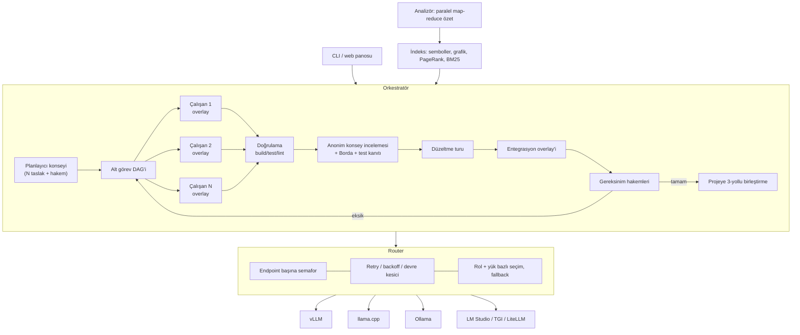

# Kurultay

**Kapalı ağda çalışan, elinizdeki tüm yerel LLM'leri aynı anda kullanan kodlama ajanı.**

Kurultay, verdiğiniz OpenAI-uyumlu endpoint'leri ve API anahtarlarını kullanarak:

1. **Her modelin yeteneklerini ölçer.** Bağlam penceresi, tool calling, JSON, hız, eşzamanlılık kapasitesi, kodlama ve düzenleme başarısı ölçülür; her modele rol puanı verilir.
2. **Projeyi indeksler.** Semboller, bağımlılık grafiği, PageRank ve BM25 araması çıkarılır. Ardından **tüm modellere paralel dağıtılan** map-reduce özetleme ile `ARCHITECTURE.md` ve modül dokümanları üretilir.
3. **Verilen işi yapar.** Plan modellerden oluşan bir konseyde hazırlanır. Alt görevler modellere **eşzamanlı** dağıtılır. Kritik işlerde birden çok model yarışır. Her aday build/test ile doğrulanır. Adaylar **anonim konsey incelemesi** ile sıralanır. Son olarak gereksinim kontrolü yapılır; eksik varsa döngü devam eder.

Çalışma zamanında **hiçbir npm bağımlılığı yoktur**. Gereken tek şey Node.js ≥ 20. Native derleme, Python, Docker, CDN veya telemetri gerekmez.

> Adı: *Kurultay*, Türk-Moğol geleneğinde kararların birlikte alındığı meclis. Buradaki meclis üyeleri sizin LLM'leriniz.

---

## Neden?

Bu projeden önce 15 açık kaynak ajan incelendi. Hiçbiri aynı işi tüm yerel modellere eşzamanlı dağıtıp sonuçları test ve çapraz review ile birleştirmiyordu. Hepsi ya rol bazlı çalışıyordu (her ajana tek model) ya da birbirinden habersiz paralel instance'lar açıyordu. Kurultay bu boşluğu doldurur ve incelenen projelerin en iyi fikirlerini bir araya getirir:

| Fikir | Kaynak proje | Kurultay'da |
|---|---|---|
| Tree-sitter + PageRank repo haritası | Aider | `src/index/*` – bağımlılıksız sembol çıkarıcı, referans grafiği, kişiselleştirilmiş PageRank |
| Architect / Editor ayrımı | Aider | Planlayıcı ve kodlayıcı rolleri, rol puanına göre model seçimi |
| Rol bazlı model yönlendirme + fallback zinciri | omp, oh-my-openagent | `Router` – rol puanı × yük × güvenilirlik; otomatik yedek model |
| Hash/anchor tabanlı dayanıklı düzenleme | omp | `edits.ts` – birebir → boşluk toleranslı → girinti toleranslı eşleşme, "en yakın eşleşme" ipucu |
| Minimal, genişletilebilir çekirdek | Pi (pi-mono) | Küçük modüller; kütüphane olarak da kullanılabilir (`import { Orchestrator } from 'kurultay'`) |
| Sisyphus orkestrasyonu / TODO takibi | oh-my-openagent | Plan DAG'i, bağımlılık sırasıyla paralel yürütme, iterasyon döngüsü |
| Git worktree ile paralel ajan izolasyonu | Kilo Code, Cline | **Copy-on-write overlay**: worktree'den hafif, repo kopyası gerektirmez, 3-yollu birleştirme yapar |
| LSP/sembol düzeyinde gezinme | Serena, Crush | `find_symbol`, `repo_map`, bağımlı dosya listesi araçları |
| Hiyerarşik wiki / mimari dokümanı | DeepWiki-Open | Dosya → modül → mimari özetleri, deterministik Mermaid modül grafiği |
| LLM Konseyi (anonim karşılıklı değerlendirme + başkan) | karpathy/llm-council | Plan, mimari dokümanı, kod incelemesi ve `ask` komutunda konsey |
| Prompt tabanlı tool calling yedeği | OpenHands, Goose (toolshim) | Native tool desteklemeyen modeller `<tool_call>`, Qwen3-Coder XML veya SEARCH/REPLACE ile çalışır |
| Bağlam yoğunlaştırıcı (condenser), event-sourcing | OpenHands | Uzun oturumlarda geçmiş özetlenir; tüm olaylar `events.jsonl` dosyasına yazılır |
| Diğer ajanların kural dosyalarını okuma | omp | `AGENTS.md`, `CLAUDE.md`, `.cursorrules`, `.clinerules/`, `.github/copilot-instructions.md` |
| Plan → Act akışı, headless mod | Cline, Qwen Code | `run` komutu tek seferde plan + uygulama yapar; CI'da etkileşimsiz çalışır |

Lisans gerekçesiyle **hiçbir projeden kod kopyalanmadı**; fikirler sıfırdan, MIT lisansıyla yeniden yazıldı. FSL lisanslı Crush yalnızca fikir kaynağı olarak incelendi.

---

## Mimari



### Tüm modeller nasıl eşzamanlı kullanılıyor?

| Aşama | Eşzamanlılık |
|---|---|
| `probe` | Tüm endpoint'ler paralel incelenir. Her endpoint'te 1→2→4→8 istekle verim rampası yapılır ve en iyi paralellik seviyesi kaydedilir. |
| `analyze` | Dosya partileri **tüm modellerin toplam slot sayısı** kadar paralel özetlenir; hızlı model daha çok iş alır (yük duyarlı router). Mimari dokümanı için N model bağımsız taslak yazar, hakem model birleştirir. |
| Planlama | En iyi 3 planlayıcı paralel taslak üretir, hakem birleştirir. |
| Yürütme | **split**: bağımsız alt görevler farklı modellerde aynı anda çalışır. **race**: aynı alt görevi N model yarışarak çözer. **council**: race + her durumda tam konsey incelemesi. **auto**: tek alt görevde race, çok alt görevde split (kritik olanlar 2 modelle). |
| İnceleme | Tüm gözden geçirenler paralel çalışır; adaylar A/B/C olarak anonimleştirilir ve sıraları karıştırılır. |
| Gereksinim kontrolü | 2 hakem paralel karar verir; ikisinin de "tamam" demesi gerekir. |

### Dayanıklılık

- **Bağlantı koparsa** üstel backoff ile tekrar denenir. Model düşerse iş diğer modele devredilir. Tüm modeller düşerse 10 dakikaya kadar bekleyip yeniden denenir (devre kesiciler sıfırlanır).
- **Bağlam taşarsa** prompt'u sığdıran modellere yönlendirilir. Uzun çalışmalarda condenser geçmişi özetler.
- **Native tool calling desteklemeyen** veya `tools` alanını reddeden sunucularda otomatik olarak prompt tabanlı araç çağrısına geçilir.
- **Çökme güvenliği**: Build/test sırasında aday değişiklikler geçici olarak diske yazılır. Bu işlem bir journal ile korunur; yarıda kesilirse bir sonraki çalıştırmada orijinal dosyalar geri yüklenir. Bu süre boyunca diğer çalışanlar her zaman orijinal (pristine) içeriği görür.
- **Sizin değişiklikleriniz korunur**: Ajan çalışırken bir dosyayı siz de düzenlediyseniz sonuç 3-yollu birleştirilir. Çakışma olursa git tarzı işaretler eklenir ve raporda listelenir.

---

## Kurulum (kapalı ağ)

İnternet erişimi olan bir makinede:

```bash
git clone https://github.com/ozknScalebor/kurultay.git
cd kurultay
npm ci            # yalnızca derleme araçları (typescript)
npm test          # ≈155 test – sahte LLM sunucularıyla birim, entegrasyon ve CLI
npm run pack:offline
```

`release/` klasörü oluşur:

- `kurultay-0.1.0.tgz`: Hedef makinede `npm install -g ./kurultay-0.1.0.tgz` ile kurulur. Çalışma zamanı bağımlılığı olmadığı için internet gerektirmez.
- `kurultay-0.1.0-portable-<os>-<arch>/`: **Node.js kurulu olmayan** makineler için. İçinde Node çalıştırıcısı vardır; `./kurultay` (Windows'ta `kurultay.cmd`) ile çalışır. Hedef makineyle aynı işletim sistemi ve mimaride paketleyin.

Bu klasörü USB ile kapalı ağa taşımanız yeterli.

## Hızlı başlangıç

```bash
cd /projem
kurultay init        # kurultay.config.json + .kurultay/rules, skills, review_rules.md şablonları
# kurultay.config.json içindeki endpoint adreslerini ve anahtarları düzenleyin
kurultay probe       # model yetenek raporu → .kurultay/CAPABILITIES.md
kurultay analyze     # indeks + tüm modellerle özet → .kurultay/ARCHITECTURE.md
kurultay run "UART sürücüsüne DMA desteği ekle; mevcut testler geçmeli" --ui
```

GPU'nuz yoksa veya önce denemek istiyorsanız sahte LLM sunucusunu kullanabilirsiniz: `kurultay mock --port 9100`. Endpoint olarak `http://127.0.0.1:9100/v1` verin.

## Komutlar

| Komut | Açıklama |
|---|---|
| `kurultay init` | Yapılandırma ve kural şablonlarını oluşturur; build/test komutlarını tahmin eder (CMake, Meson, Maven, Gradle, Cargo, Go, npm, pytest, Make) |
| `kurultay probe [--deep] [--quick]` | Yetenek analizi. `--deep` 256K bağlama ve 16 eşzamanlı isteğe kadar ölçer; `--quick` benchmark'ı atlar |
| `kurultay index` | Yalnızca statik indeks (LLM gerekmez) |
| `kurultay analyze [--force] [--drafts N]` | Paralel özetleme ve mimari dokümanı. Artımlıdır: yalnızca değişen dosyalar yeniden özetlenir |
| `kurultay run "<görev>"` | `--mode auto\|single\|split\|race\|council`, `--req gereksinim.md`, `--dry-run`, `--yes`, `--ui` |
| `kurultay ask "<soru>"` | Proje hakkında soru; modeller ayrı ayrı cevaplar, başkan model birleştirir |
| `kurultay map [--tokens N] [--focus a,b]` | Repo haritası (Aider tarzı) |
| `kurultay search "<sorgu>"` | BM25 kod araması |
| `kurultay status` | Modeller, indeks ve son oturumlar |

`--ui` seçeneği `http://127.0.0.1:7420` adresinde, harici kaynak kullanmayan **canlı bir pano** açar. Panoda her modelin yükü ve her çalışanın adımları yan yana izlenir.

## Yapılandırma

Tam örnek: [`examples/kurultay.config.example.json`](examples/kurultay.config.example.json)

```jsonc
{
  "endpoints": [
    { "name": "gpu1", "baseUrl": "http://10.0.0.11:8000/v1", "apiKey": "${GPU1_API_KEY}" },
    { "name": "ollama", "baseUrl": "http://127.0.0.1:11434/v1", "apiKey": "ollama", "models": ["qwen2.5-coder:14b"] }
  ],
  "models": { "gpt-oss-120b@gpu1": { "roles": ["planner", "judge"] } },   // isteğe bağlı rol sabitleme
  "verify": { "build": "cmake --build build -j", "test": "ctest --test-dir build" },
  "orchestrator": { "defaultMode": "auto", "raceWidth": 3, "councilSize": 3, "maxIterations": 4, "confirmMerge": true }
}
```

- `models` boş bırakılırsa liste `GET /models` ile keşfedilir. Embedding ve reranker modelleri otomatik olarak elenir.
- `maxConcurrency: 0` ise endpoint'in paralellik limitini probe belirler.
- `apiKey` alanında `${ORTAM_DEGISKENI:-varsayılan}` sözdizimi kullanılabilir.

## Kurallar ve skill'ler

| Dosya | Kullanım |
|---|---|
| `.kurultay/rules/*.md` | Her çalışana verilen kurallar. Frontmatter'da `applies_to: "*.java"` varsa yalnızca ilgili dosyalarda uygulanır |
| `.kurultay/skills/*.md` | Adım adım iş tarifleri. Görev metniyle eşleşen skill'ler bağlama eklenir |
| `review_rules.md` veya `.kurultay/review_rules.md` | Konsey incelemesinde zorunlu kurallar |
| `AGENTS.md`, `CLAUDE.md`, `.cursorrules`, `.clinerules/`, `.github/copilot-instructions.md` | Diğer ajanların kural dosyaları dönüştürmeden okunur |

## Üretilen dosyalar (`.kurultay/`)

```
capabilities.json, CAPABILITIES.md   model yetenek profili
index/index.json                     semboller, grafik, PageRank, özetler (artımlı)
ARCHITECTURE.md, INDEX.md            mimari özet ve dosya indeksi
modules/*.md                         modül dokümanları
sessions/<id>/                       plan.json, events.jsonl, session.json, changes.diff, REPORT.md
```

## Güvenlik

- Ajanlar yalnızca proje kökü içinde dosya okuyup yazabilir. `.git` ve `.kurultay` korunur.
- Komutlar `tools.denyPatterns` ile filtrelenir. Varsayılan olarak `rm -rf /`, `mkfs`, `dd`, `git push`, `curl | sh` gibi komutlar reddedilir. İsterseniz `tools.allowCommands: false` ile komut çalıştırmayı tamamen kapatabilirsiniz.
- `confirmMerge: true` ayarıyla değişiklikler projeye uygulanmadan önce onay istenir. `--dry-run` ile sonuç yalnızca `changes.diff` olarak bırakılır.

## Kütüphane olarak kullanım

```ts
import { createApp, loadOrBuildIndex, Orchestrator } from 'kurultay';
const app = await createApp({ root: '/projem' });
const { index } = loadOrBuildIndex(app);
const report = await new Orchestrator(app.root, app.config, app.router, app.materializer, index, app.bus)
  .run('Görev metni', { mode: 'race' });
```

## Sınırlamalar ve yol haritası

- Sembol çıkarıcı native derleme gerektirmemek için regex/sezgisel tabanlıdır. C, C++, Java, Kotlin, C#, Python, JS/TS, Go ve Rust desteklenir. Yol haritasında: isteğe bağlı `web-tree-sitter` (WASM) ve `clangd`/`jdtls` LSP entegrasyonu.
- Gömme (embedding) tabanlı vektör arama henüz yok; şimdilik BM25 + repo haritası kullanılıyor. Yol haritasında: yerel embedding endpoint'i ile hibrit arama.
- Oturum sürdürme (`--resume`) için durum `session.json` dosyasına kaydediliyor; CLI komutu henüz eklenmedi.
- Yerel modellerle kalite, modellerin kendisiyle sınırlıdır. Kurultay'ın race + test + konsey yaklaşımı tek bir zayıf modelin hatalarını eler, ancak hiçbir model çözemiyorsa sonuç `incomplete` olur ve rapor eksikleri listeler.

## Geliştirme ve testler

```bash
npm ci
npm test                  # birim + entegrasyon + CLI (≈155 test)
npm run test:unit         # yalnızca birim testleri
npm run test:integration  # sahte çoklu-model LLM sunucularıyla entegrasyon
npm run test:cli          # gerçek CLI'ı alt süreç olarak uçtan uca çalıştırır
npm run test:package      # offline paketleme + internetsiz kurulum + taşınabilir başlatıcı
npm run test:coverage     # kapsam eşikleri: satır ≥ %95, dal ≥ %85, fonksiyon ≥ %93
```

| Katman | Ne test ediliyor |
|---|---|
| `test/unit` | Router (seçim, retry, devre kesici, auth/bağlam hataları, kurtarma beklemesi, zaman aşımı, iptal, eşzamanlılık limiti), OpenAI istemcisi (SSE, reasoning, tool-call delta, hata sınıflandırma, başlıklar), araçlar ve güvenlik (yol kaçışı, yasaklı komutlar, salt-okunur), overlay/3-yollu birleştirme/çökme kurtarma, düzenleme ayrıştırıcıları, 9 dilde sembol çıkarma, import çözümü, tarayıcı, indeks, konsey (anonimlik, test kanıtı önceliği), planlayıcı, doğrulama, yapılandırma |
| `test/integration` | Ajan döngüsü (native/metin/Qwen-XML araçları, tools reddi, boşta kalma, adım sınırı, condenser, model düşmesi), orkestratör (split+bağımlılık, iterasyon, build-düzeltme, çakışma, onay, kurallar, çökme kurtarma, iptal), probe (merdiven, gömme filtresi, erişilemezlik), analiz (partiler, hata toleransı, artımlılık), pano ve terminal |
| `test/cli` | `init`, `probe`, `index`, `analyze`, `run`, `ask`, `map`, `search`, `status`; çıkış kodları ve hata mesajları |
| `test/package` | `npm pack` içeriği, registry olmadan kurulum, gömülü Node ile taşınabilir paket |

### CI pipeline (`.github/workflows/ci.yml`)

```
statik kontroller ─┬─ birim       (Linux/Windows/macOS × Node 20/22)
                   ├─ entegrasyon (Linux/Windows × Node 20/22)
                   └─ CLI         (Linux/Windows/macOS)
                          └─┬─ kapsam eşiği
                            └─ offline paket (Linux/Windows/macOS → artefakt)
                                  └─ sürüm yayını (v* etiketi → GitHub Release)
```

Başarısız testler GitHub üzerinde hata notu (annotation) olarak, sonuç ve kapsam tabloları iş özeti (job summary) olarak görünür. `v0.2.0` gibi bir etiket gönderildiğinde her platformun offline paketi otomatik olarak Release'e eklenir.

Lisans: MIT
